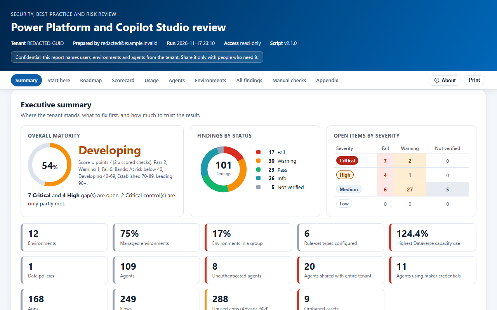
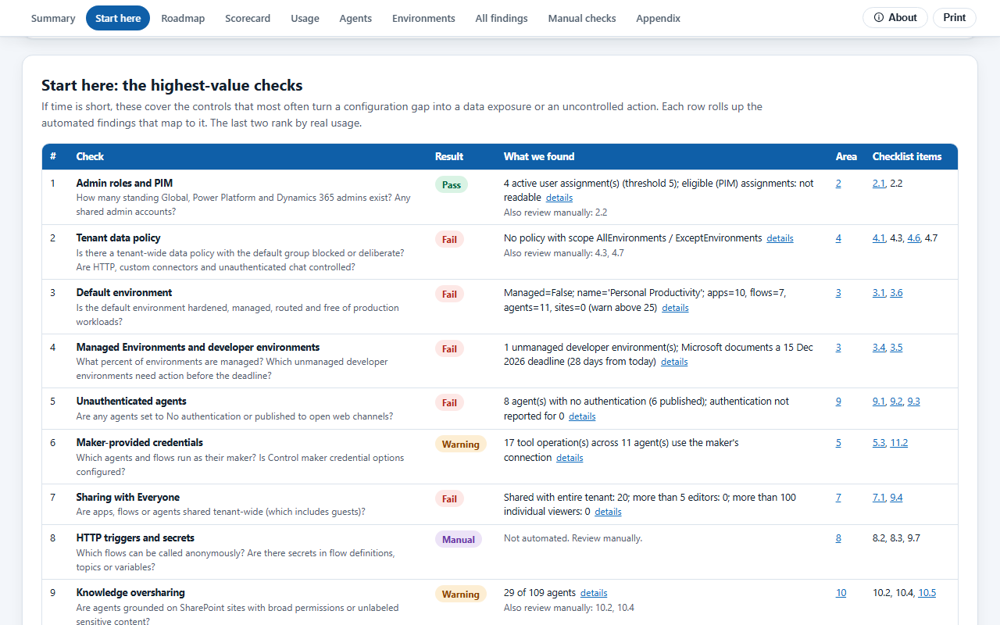
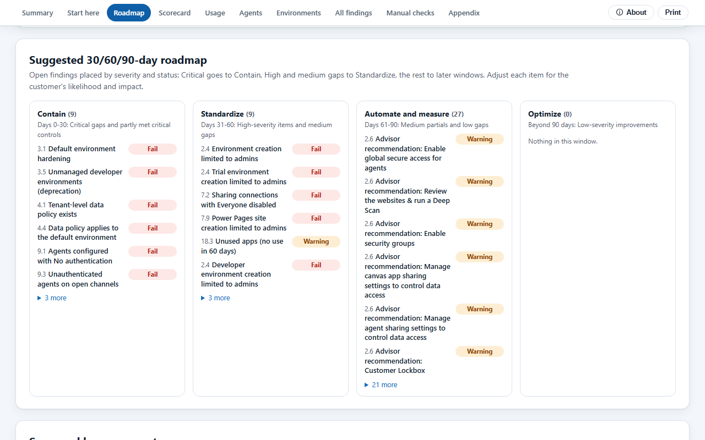
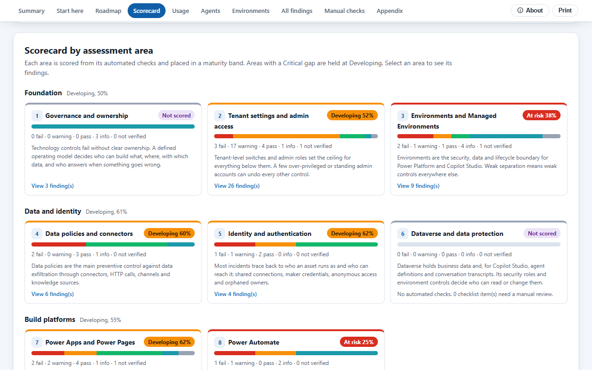
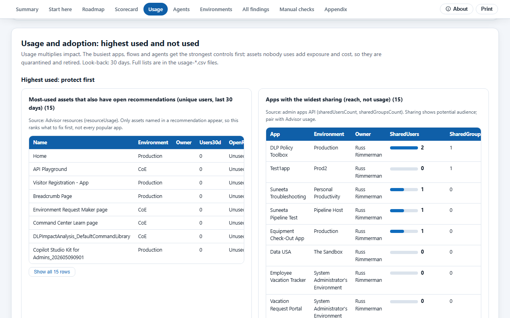
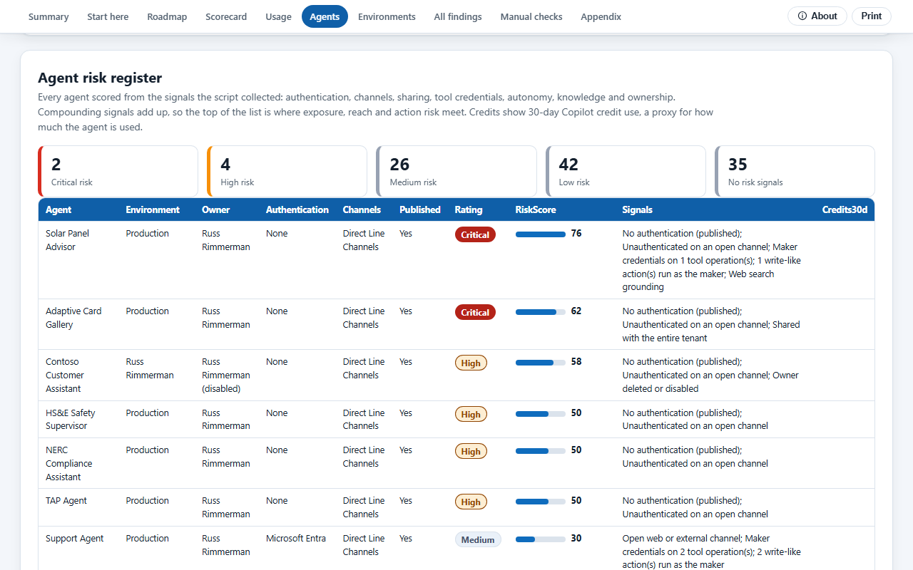
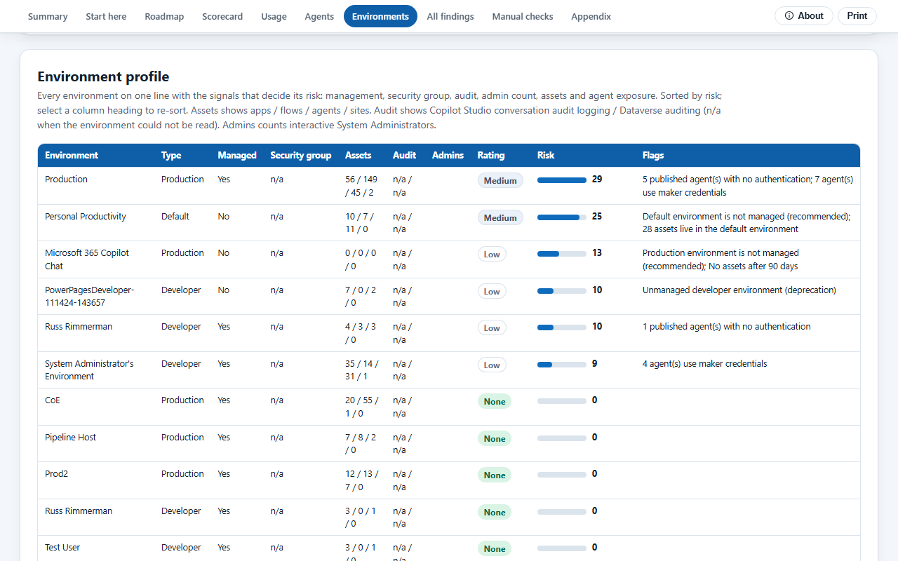
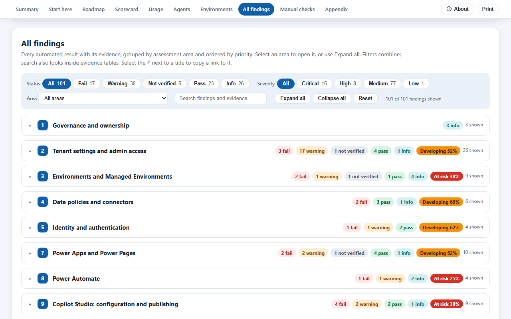
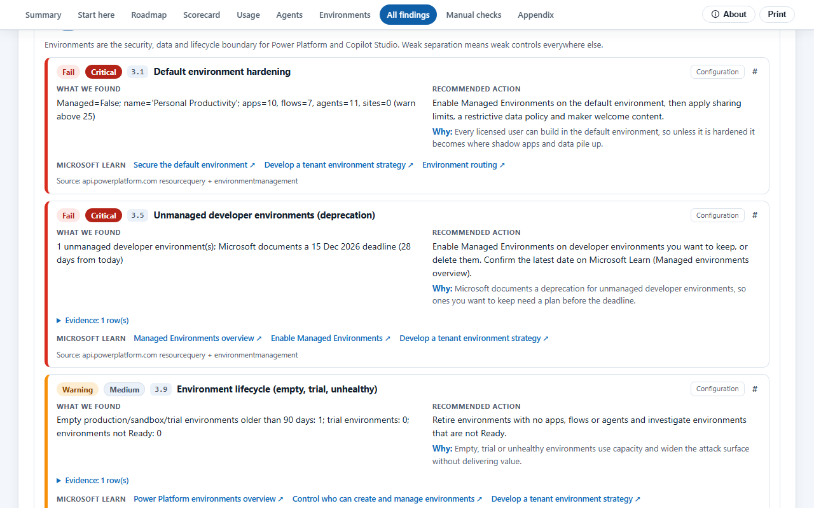

# Power Platform and Copilot Studio governance review

`Invoke-PPCSReview.ps1` is a single PowerShell script that reviews the governance and security posture of a Power Platform tenant, including Copilot Studio agents. It only reads. It writes one self-contained HTML report plus CSV and JSON exports that show the current state, what to fix first, why, and where to read more on Microsoft Learn.

> **Not an official Microsoft product.** This is a personal creation of Russ Rimmerman (Cloud Solution Architect), built to help customers evaluate the current state of their overall Power Platform governance. It is not supported by Microsoft. See the disclaimer at the top of the script.

## What the report looks like

The screenshots below come from the redacted sample report. [Open the full sample report](docs/sample-report/PowerPlatformCopilotStudioAudit.html) (download it and open it in a browser; GitHub shows HTML files as source, not rendered).

**Executive summary:** maturity band and score, findings by status, open items by severity, and headline numbers.



**Start here:** the 16 highest-value checks, each with its result, what was found and the checklist items behind it.



**30/60/90-day roadmap:** open items grouped into Contain, Standardize, Automate and measure, and Optimize.



**Scorecard:** each of the 18 governance areas scored and placed in a maturity band.



**Usage and adoption:** the busiest and unused apps, flows and agents, so the strongest controls go where they matter most.



**Agent risk register:** every Copilot Studio agent scored from its authentication, channels, sharing, credentials and knowledge signals.



**Environment profile:** every environment on one line with its management, assets, rating and risk flags.



**All findings:** filterable by status, severity and area, with evidence behind every result.



**A single finding:** what we found, the recommended action, why it matters, and Microsoft Learn references.



## Contents

- [What the report looks like](#what-the-report-looks-like)
- [What you get](#what-you-get)
- [What's new](#whats-new)
- [Quick start](#quick-start)
- [Access required](#access-required)
- [Parameters](#parameters)
- [How a review runs](#how-a-review-runs)
- [Reading the report](#reading-the-report)
- [What it checks](#what-it-checks)
- [Risk signals behind the agent and environment ratings](#risk-signals-behind-the-agent-and-environment-ratings)
- [What it does not check](#what-it-does-not-check)
- [Output files](#output-files)
- [Data handling and safety](#data-handling-and-safety)
- [Troubleshooting](#troubleshooting)
- [Repository contents](#repository-contents)
- [Related tools](#related-tools)
- [Contributing, license and contact](#contributing-license-and-contact)

## What you get

- **Maturity band and score** (At risk, Developing, Established, Leading) with the number of Critical and High gaps.
- **Fix these first:** the highest-priority open items, each with a one-sentence **Do** and a one-sentence **Why**.
- **Start here:** the framework's 16 highest-value checks, each rolled up from the findings behind it.
- **30/60/90-day roadmap:** open items grouped into Contain, Standardize, Automate and measure, and Optimize.
- **Scorecard** for 18 governance areas, a **usage lens** (highest-used and not-used apps, flows, agents and Power Pages sites), an **agent risk register** and an **environment profile**, each with the signals listed beside the score.
- **Every finding** with status, severity, confidence, an evidence table, the recommended action, why it matters, and two or three Microsoft Learn references.
- **Manual checks:** framework items that cannot be automated, so nothing is silently skipped.
- **Since the last run:** new, resolved, improved and regressed findings when you pass a previous run as a baseline.
- **Data collection health:** which API calls failed and why, so a gap in the data is never mistaken for a pass.

The checks map to the numbered items in the assessment framework (`PowerPlatform_CopilotStudio_Security_Review_v2.docx`). About 90 of its 167 items are automated, fully or in part; the rest appear as manual checks.

## What's new

Version 2.1.0 (see [CHANGELOG.md](CHANGELOG.md)):

- **Managed Environments coverage is informational and recommended**, not a Fail or Critical gap. How far to roll it out is each customer's decision.
- **A "Why" line under every "Do"** in "Fix these first" and in each finding card.
- **Dataverse environment security checks:** IP firewall, IP address-based cookie binding, content security policy, session and inactivity timeouts (all informational and recommended), and guest access to Dataverse.
- **Copilot Studio agent access checks:** agents reachable from other Microsoft Entra tenants (multitenant mode), agents that do not ask for sign-in up front, and who holds the Bot Transcript Viewer role.
- **Managed Environment settings:** sharing limits on the default environment for canvas apps and agents, solution checker enforcement, and maker welcome content.
- **Microsoft Learn links on every finding**, an About dialog, a Microsoft blue theme, and a complete reference of every check in this file.

## Quick start

Requirements: PowerShell 7 or later (recommended; Windows PowerShell 5.1 works but can fail on large inventory responses) and a signed-in user with the access described below. The default sign-in needs no modules.

```powershell
# Interactive sign-in with a device code, open the report when done
.\Invoke-PPCSReview.ps1 -OpenReport

# A specific customer tenant, skipping the checks you cannot access
.\Invoke-PPCSReview.ps1 -TenantId contoso.onmicrosoft.com -CustomerName "Contoso" -SkipDataverse -SkipEntra

# Reuse an Az.Accounts session (Install-Module Az.Accounts)
.\Invoke-PPCSReview.ps1 -AuthMethod Az

# Power Platform API only, with a token you already have (kept out of shell history)
$env:PPCS_ACCESS_TOKEN = '<token for https://api.powerplatform.com>'
.\Invoke-PPCSReview.ps1 -AuthMethod Token

# Compare with a previous run
.\Invoke-PPCSReview.ps1 -BaselinePath .\PPCS-Review-20261101-090000
```

Each run writes a `PPCS-Review-<timestamp>` folder. Open `report.html`. Run `Get-Help .\Invoke-PPCSReview.ps1 -Full` for every parameter.

## Access required

The script only reads. It runs as a signed-in user; service principals are not supported because the inventory API returns 403 to them. Anything the signed-in user cannot read is reported as **Not verified** rather than guessed.

| Data source | What the script reads | Minimum access | If access is missing |
|---|---|---|---|
| Power Platform API (`api.powerplatform.com`) | Inventory of apps, flows, agents, Power Pages sites, connectors and environments; environment management and settings; governance rule sets and cross-tenant connection reports; Advisor recommendations; licensing (capacity, billing policies, Copilot credit entitlements and consumption); flow runs; app sharing counts | Power Platform Administrator or Global Administrator | Affected checks are Not verified. Inventory-based checks need this access. |
| Business Application Platform (`api.bap.microsoft.com`) | Tenant settings, tenant isolation, data policies, Managed Environment settings. Best effort: there is no `api.powerplatform.com` equivalent yet. | Power Platform Administrator or Global Administrator | Not verified. Skip with `-SkipLegacyApis`. |
| Microsoft Graph (`graph.microsoft.com`) | Admin role assignments and PIM eligibility, Conditional Access policies, owner lookup for orphaned assets | Global Reader (or another directory reader role) plus delegated `Directory.Read.All`, `RoleManagement.Read.Directory` and `Policy.Read.All` with admin consent | Not verified. Skip with `-SkipEntra`. |
| Dataverse Web API (one call set per environment) | Auditing, System Administrators, conversation transcripts, solutions, role members, environment security settings, agent access settings, agent topics and knowledge, flow definitions | A security role that can read those tables in each scanned environment, typically System Administrator. Tenant admins must elevate themselves in each environment first. | That environment is Not verified. Skip with `-SkipDataverse` or lower `-MaxDataverseEnvironments`. |

Optional components: `Az.Accounts` for `-AuthMethod Az`, and `Microsoft.PowerApps.Administration.PowerShell`, which is used only as a fallback for data policies when the BAP endpoints do not answer.

**About the default sign-in.** Device code sign-in uses `-ClientId`, which defaults to the public Microsoft Azure PowerShell client (`1950a258-227b-4e31-a9cf-717495945fc2`, listed in [Commonly used Microsoft first-party services](https://learn.microsoft.com/en-us/power-platform/admin/apps-to-allow)). The script asks for `/.default` scopes for each resource, so what it can read depends on the consent your tenant has granted to that client. If the Entra checks return 403, supply your own public-client app registration with `-ClientId`, or use `-AuthMethod Az`. That path has not been tested with every tenant configuration.

## Parameters

| Parameter | Default | Purpose |
|---|---|---|
| `-TenantId` | `organizations` | Tenant domain or ID to sign in to. |
| `-AuthMethod` | `DeviceCode` | `DeviceCode` uses the OAuth device code flow. `Az` uses or starts an `Az.Accounts` session. `Token` uses `-AccessToken` for the Power Platform API only, so Graph, BAP and Dataverse checks are skipped. |
| `-ClientId` | `1950a258-227b-4e31-a9cf-717495945fc2` | Public client for device code sign-in. |
| `-AccessToken` | none | Bearer token for `https://api.powerplatform.com` with `-AuthMethod Token`. If omitted, the `PPCS_ACCESS_TOKEN` environment variable is used. |
| `-OutputPath` | `.\PPCS-Review-<timestamp>` | Folder for the report and exports. |
| `-ChecklistPath` | `PPCS-Checklist.csv` next to the script | Framework checklist. When present, items that are not automated are listed as manual checks and coverage is calculated. |
| `-PowerPlatformApiHost`, `-BapApiHost`, `-GraphHost`, `-BapResource` | `api.powerplatform.com`, `api.bap.microsoft.com`, `graph.microsoft.com`, `https://service.powerapps.com` | Endpoint overrides, for example for sovereign clouds (not tested). |
| `-SkipLegacyApis` | off | Skip everything read from `api.bap.microsoft.com`: tenant settings, tenant isolation, data policies and Managed Environment settings. |
| `-SkipEntra` | off | Skip Microsoft Graph checks: admin roles, PIM, Conditional Access and owner lookup. |
| `-SkipDataverse` | off | Skip every per-environment Dataverse check. |
| `-SkipDeepScan` | off | Skip the agent topic, knowledge and trigger scan and the flow definition scan (the heaviest Dataverse reads). The agent access settings check still runs. |
| `-SkipUsage` | off | Skip the usage and adoption analysis. |
| `-MaxDataverseEnvironments` | `10` | Environments scanned in Dataverse, default then production then sandbox first. A capped scan is labeled Sample. |
| `-MaxEnvironmentSettingsCalls` | `200` | Environments whose management settings and Managed Environment settings are read. |
| `-MaxAgentComponentsPerEnvironment` | `2000` | Agent components (topics, knowledge, triggers) read per environment. |
| `-MaxFlowDefinitionsPerEnvironment` | `300` | Cloud flow definitions read per environment. |
| `-MaxEntitlementEnvironments` | `100` | Environments whose Copilot credit entitlements are read. |
| `-FlowRunSampleLimit` | `100` | Cloud flows sampled for run history. `0` skips run history. |
| `-MaxAppSharingEnvironments` | `25` | Environments (those with the most apps) whose app sharing counts are read. |
| `-UsageLookbackDays` | `30` | Look-back for credit consumption and flow runs. |
| `-StaleDays` | `365` | Age after which an app, flow, published agent or widely shared app counts as dormant when not modified. |
| `-DefaultEnvironmentAssetWarnThreshold` | `25` | Apps, flows, agents and sites in the default environment above which it is flagged. |
| `-DeveloperEnvironmentDeadline` | `2026-12-15` | Date by which unmanaged developer environments must be managed or removed. Confirm the latest date on [Managed environments overview](https://learn.microsoft.com/en-us/power-platform/admin/managed-environment-overview). |
| `-TopN` | `15` | Rows in each top-N list. |
| `-EvidenceRowLimit` | `500` | Evidence rows written per finding CSV. The report shows the first 50. |
| `-BaselinePath` | none | A previous run folder or its `findings.json`, for the "Since the last run" section. |
| `-CustomerName`, `-PreparedBy` | none, signed-in user | Shown on the report cover and in `run-summary.json`. |
| `-OpenReport` | off | Open the report when the run finishes. |

## How a review runs

1. **Sign in** with the chosen method and read the tenant ID from the token.
2. **Load the inventory** (environments, environment groups, agents, apps, flows, Power Pages sites, connector catalog) from the Power Platform API.
3. **Run each check step on its own.** A failure in one step becomes a Not verified finding and the run continues. The steps run in this order: environments, environment settings, Managed Environment settings, environment group rules, Advisor recommendations, capacity and billing, tenant settings, tenant isolation, data policies, Copilot Studio agents, apps, flows and Power Pages, usage and adoption, Copilot credit controls, owners (Graph), Entra roles and Conditional Access (Graph), shadow environments, Dataverse (per environment), Dataverse environment security settings, Dataverse access review, agent topics, knowledge and triggers, flow definitions, and agent access control and sign-in.
4. **Score and write the report** and the CSV and JSON exports.

The script never changes anything in the tenant. Every call is a read; a few read endpoints (the Resource Query API, listing tenant settings, and two Microsoft Graph lookups) use POST because the service requires it.

## Reading the report

A redacted sample of the generated report is included so you can see what it looks like: [docs/sample-report/PowerPlatformCopilotStudioAudit.html](docs/sample-report/PowerPlatformCopilotStudioAudit.html). Download it and open it in a browser (GitHub shows HTML files as source, not rendered).

The navigation bar jumps between Summary, Start here, Roadmap, Scorecard, Usage, Agents, Environments, All findings, Manual checks and Appendix. The findings list can be filtered by status, severity and area, searched, and expanded or collapsed. There is a light and a dark theme, and the page prints cleanly.

### Results

| Result | Framework term | Meaning |
|---|---|---|
| Fail | Gap (0) | The control is absent or ineffective. |
| Warning | Partial (1) | The control exists but is inconsistent, incomplete or only partly evidenced. |
| Pass | Meets (2) | The automated test passed. It is not proof that the whole checklist item is satisfied. |
| Info | Not scored | Context, inventory, or an optional recommendation. It does not change the score. |
| Not verified | Not verified | The data could not be read (permissions, a preview endpoint, or the tenant lacks the feature). Treat it as unknown, never as a pass. The CSV and JSON files call this status `Unavailable`. |
| Manual | Not automated | A framework item the script cannot test. Review it by hand. |

### Severity, confidence and scoring

- **Severity** (Critical, High, Medium, Low) is the checklist's default priority: how serious the item is if it is a gap. Adjust it for likelihood and impact in the customer's context. It is shown only on items that need action or verification.
- **Confidence** tells you how much to trust a result. **Configuration**: read directly from the service. **Sample**: covers only part of the tenant because of a scan cap or sampling. **Heuristic**: pattern-based detection such as secret scanning or write-like tool names, so verify before reporting. **Not verified**: could not be read.
- **Score** is points divided by twice the number of scored checks, where Pass is 2, Warning is 1 and Fail is 0. Info and Not verified are not scored. Bands: below 40 At risk, 40 to 69 Developing, 70 to 89 Established, 90 and above Leading.
- **Critical gaps** are Fail results with Critical severity. An area or the overall result is held at Developing while it has a Critical gap.
- **Not rated and Provisional.** Fewer than 10 scored checks means no band is shown. If 25% or more of the checks could not be verified, the rating is marked Provisional.
- **Optional features are never gaps.** Features that each customer decides on (Managed Environments coverage, IP firewall, cookie binding, content security policy, session timeouts, sharing limits and solution checker enforcement) are reported as Pass when adopted or Info with a "Recommended" action when not.

### Fix these first, roadmap and Start here

- **Fix these first** ranks every Fail and Warning (and Not verified items of High or Critical severity) by severity, then by Fail before Warning. Findings with the same root cause, such as orphaned assets, are shown once.
- **Roadmap** places the same items: Critical goes to Contain, High to Standardize, Medium to Standardize (Fail) or Automate and measure (Warning), and Low to Automate and measure (Fail) or Optimize (Warning).
- **Start here** rolls up the framework's 16 highest-value checks: admin roles and PIM; tenant data policy; default environment; Managed Environments and developer environments; unauthenticated agents; maker-provided credentials; sharing with Everyone; HTTP triggers and secrets; knowledge oversharing; write tools and autonomy; audit and detection; ownership and orphaned assets; transcripts; spend controls; most-used assets; unused assets.

### Governance KPIs

The summary tiles and finding 14.8 track: environments, managed environments %, environments in a group %, data policies, rule-set types configured, agents, unauthenticated agents, agents shared with the entire tenant, agents using maker credentials, autonomous agents, apps, flows, orphaned assets, highest Dataverse capacity use %, environments drawing on the credit tenant pool, unused apps, sites without traffic, published agents with no credit use, and flows with no runs (sample). Run monthly with `-BaselinePath` to see the trend.

## What it checks

Every automated finding is listed below, grouped like the report: six sections and 18 areas. IDs are the numbered items of the assessment framework. A few IDs carry several findings. For each finding you get how it is rated, the **Do** and **Why** shown in the report, and the same Microsoft Learn references the report links to.

- **How it is rated** names the result each condition produces. "Critical", "High" and similar words are the severity used when the finding is a gap.
- **Heuristic** findings are pattern-based. **Sample** findings read only part of the tenant. Neither is proof; verify before reporting.
- Findings that say "Needs the Dataverse agent scan" or "flow definition scan" run unless you pass `-SkipDataverse` or `-SkipDeepScan`.
- Where an item needs data the signed-in user cannot read, the finding is **Not verified** instead of Pass.
- A finding labeled `<Role>`, `<scenario>`, `<policy>` or `<N>` repeats once per role, Advisor scenario, policy or configured number of days.
- Findings with no **Do** are informational. They show inventory or context, and appear in the report without a recommendation.

### Foundation

#### 1. Governance and ownership

*Why this area matters:* Technology controls fail without clear ownership. A defined operating model decides who can build what, where, with which data, and who answers when something goes wrong.

- **1.3** **Maker welcome content on managed environments**
  - **Rated:** Pass when every assessed managed environment (outside environment groups) has welcome content, otherwise Info. Judged only when the environment API returns the welcome fields; if it does not, nothing is reported and the item stays on the manual list. Never a gap.
  - **Do (optional):** add maker welcome content that explains what the environment is for, which data is allowed and who to ask for help (PPAC > Environments > Edit Managed Environments > Maker welcome content).
  - **Why:** Welcome content tells new makers where to build, what data is allowed and who to ask, before they create anything.
  - **Learn:** [Maker welcome content](https://learn.microsoft.com/en-us/power-platform/admin/welcome-content); [Implement reactive governance controls](https://learn.microsoft.com/en-us/power-platform/guidance/adoption/reactive-governance); [Rules for environment groups](https://learn.microsoft.com/en-us/power-platform/admin/environment-groups-rules)
- **1.3** **Environment group rule: MakerOnboarding**
  - **Rated:** Pass when at least one environment group rule set of this type exists, otherwise Info.
  - **Do:** No action; informational.
  - **Learn:** [Rules for environment groups](https://learn.microsoft.com/en-us/power-platform/admin/environment-groups-rules); [Environment groups](https://learn.microsoft.com/en-us/power-platform/admin/environment-groups)
- **1.6** **Asset inventory totals**
  - **Rated:** Informational. Counts of apps, flows, agents and Power Pages sites from the inventory.
  - **Do:** No action; informational.
  - **Learn:** [Power Platform inventory](https://learn.microsoft.com/en-us/power-platform/admin/power-platform-inventory); [Power Platform inventory API](https://learn.microsoft.com/en-us/power-platform/admin/inventory-api); [Manage your Copilot Studio projects](https://learn.microsoft.com/en-us/microsoft-copilot-studio/guidance/sec-gov-intro)
- **1.7** **Agent registry from inventory**
  - **Rated:** Informational. Agents by creating surface and harness, with owner, authentication, channels and publish date.
  - **Do:** Reconcile this registry with Microsoft 365 admin center Agents and any Foundry agents; every agent needs an owner and lifecycle state.
  - **Why:** You cannot govern what you cannot see, so a current inventory of apps, flows and agents is the baseline for every other control.
  - **Learn:** [Power Platform inventory](https://learn.microsoft.com/en-us/power-platform/admin/power-platform-inventory); [Power Platform inventory API](https://learn.microsoft.com/en-us/power-platform/admin/inventory-api); [Manage your Copilot Studio projects](https://learn.microsoft.com/en-us/microsoft-copilot-studio/guidance/sec-gov-intro)

#### 2. Tenant settings and admin access

*Why this area matters:* Tenant-level switches and admin roles set the ceiling for everything below them. A few over-privileged or standing admin accounts can undo every other control.

- **2.1** **`<Role>`: active members (Global Administrator, Power Platform Administrator, Dynamics 365 Administrator)**
  - **Rated:** Critical. Fail above 5 active user assignments in a role; Warning above 3 for the two Power Platform roles; otherwise Pass. Eligible (PIM) assignments are shown for comparison.
  - **Do:** Reduce standing assignments; use Environment Admin or System Administrator where possible and make the rest PIM-eligible.
  - **Why:** Standing admin accounts are the highest-value targets in the tenant, so fewer of them means less damage if one is compromised.
  - **Learn:** [Use service admin roles to manage your tenant](https://learn.microsoft.com/en-us/power-platform/admin/use-service-admin-role-manage-tenant); [Use Entra Privileged Identity Management in the admin center](https://learn.microsoft.com/en-us/power-platform/admin/manage-high-privileged-admin-roles); [Best practices for Microsoft Entra roles](https://learn.microsoft.com/en-us/entra/identity/role-based-access-control/best-practices)
- **2.2** **`<Role>`: PIM just-in-time usage**
  - **Rated:** Critical. Warning when a role has active assignments but no eligible (PIM) assignments; otherwise Pass. Skipped when eligibility cannot be read.
  - **Do:** No eligible assignments found; convert standing assignments to PIM-eligible with MFA and approval.
  - **Why:** Just-in-time activation through PIM limits how long admin rights exist and adds approval, MFA and an audit trail.
  - **Learn:** [Use service admin roles to manage your tenant](https://learn.microsoft.com/en-us/power-platform/admin/use-service-admin-role-manage-tenant); [Use Entra Privileged Identity Management in the admin center](https://learn.microsoft.com/en-us/power-platform/admin/manage-high-privileged-admin-roles); [Best practices for Microsoft Entra roles](https://learn.microsoft.com/en-us/entra/identity/role-based-access-control/best-practices)
- **2.3** **Tenant settings snapshot**
  - **Rated:** Informational. Every tenant setting the service returns, to compare with your documented baseline.
  - **Do:** No action; informational.
  - **Learn:** [Tenant settings](https://learn.microsoft.com/en-us/power-platform/admin/tenant-settings); [Power Platform governance overview and strategy](https://learn.microsoft.com/en-us/power-platform/guidance/adoption/admin-best-practices)
- **2.4** **Environment creation limited to admins**
  - **Rated:** High. Pass when `disableEnvironmentCreationByNonAdminUsers` is true, otherwise Fail. The documented service default is assumed when the tenant does not return the key.
  - **Do:** Set "Who can create production and sandbox environments" to Only specific admins in PPAC > Settings.
  - **Why:** Uncontrolled environment creation produces sprawl outside data policies, ownership and monitoring.
  - **Learn:** [Control who can create and manage environments](https://learn.microsoft.com/en-us/power-platform/admin/control-environment-creation); [Tenant settings](https://learn.microsoft.com/en-us/power-platform/admin/tenant-settings); [Develop a tenant environment strategy](https://learn.microsoft.com/en-us/power-platform/guidance/adoption/environment-strategy)
- **2.4** **Trial environment creation limited to admins**
  - **Rated:** High. Pass when `disableTrialEnvironmentCreationByNonAdminUsers` is true, otherwise Fail.
  - **Do:** Restrict trial environment creation to admins to prevent unmanaged shadow environments.
  - **Why:** Uncontrolled environment creation produces sprawl outside data policies, ownership and monitoring.
  - **Learn:** [Control who can create and manage environments](https://learn.microsoft.com/en-us/power-platform/admin/control-environment-creation); [Tenant settings](https://learn.microsoft.com/en-us/power-platform/admin/tenant-settings); [Develop a tenant environment strategy](https://learn.microsoft.com/en-us/power-platform/guidance/adoption/environment-strategy)
- **2.4** **Developer environment creation limited to admins**
  - **Rated:** Medium. Pass when `powerPlatform.governance.disableDeveloperEnvironmentCreationByNonAdminUsers` is true, otherwise Fail.
  - **Do:** Restrict developer environment creation if default environment routing is not used.
  - **Why:** Uncontrolled environment creation produces sprawl outside data policies, ownership and monitoring.
  - **Learn:** [Control who can create and manage environments](https://learn.microsoft.com/en-us/power-platform/admin/control-environment-creation); [Tenant settings](https://learn.microsoft.com/en-us/power-platform/admin/tenant-settings); [Develop a tenant environment strategy](https://learn.microsoft.com/en-us/power-platform/guidance/adoption/environment-strategy)
- **2.4** **Environments created by non-admins in the last 90 days**
  - **Rated:** High. Warning when an environment (other than the default) created in the last 90 days was created by a user who is not a Global, Power Platform or Dynamics 365 administrator; otherwise Pass.
  - **Do:** Restrict environment creation to admins and route new environments through your request process; investigate how these were created.
  - **Why:** Uncontrolled environment creation produces sprawl outside data policies, ownership and monitoring.
  - **Learn:** [Control who can create and manage environments](https://learn.microsoft.com/en-us/power-platform/admin/control-environment-creation); [Tenant settings](https://learn.microsoft.com/en-us/power-platform/admin/tenant-settings); [Develop a tenant environment strategy](https://learn.microsoft.com/en-us/power-platform/guidance/adoption/environment-strategy)
- **2.5** **Tenant isolation enabled**
  - **Rated:** Fail when tenant isolation is off; Pass when on (with the number of allow-listed tenants); Info when the policy cannot be interpreted.
  - **Do:** Turn on tenant isolation and allow-list only required tenants (PPAC > Security > Identity and access).
  - **Why:** Without tenant isolation, connectors can move data to and from other tenants outside your control.
  - **Learn:** [Restrict cross-tenant inbound and outbound access](https://learn.microsoft.com/en-us/power-platform/admin/cross-tenant-restrictions); [Tenant settings](https://learn.microsoft.com/en-us/power-platform/admin/tenant-settings)
- **2.5** **Cross-tenant connections observed**
  - **Rated:** Warning when the latest cross-tenant connection report lists connections; Pass when it lists none; Info when no report has been generated yet.
  - **Do:** Review each tenant; if not required, enable tenant isolation and block it.
  - **Why:** Without tenant isolation, connectors can move data to and from other tenants outside your control.
  - **Learn:** [Restrict cross-tenant inbound and outbound access](https://learn.microsoft.com/en-us/power-platform/admin/cross-tenant-restrictions); [Tenant settings](https://learn.microsoft.com/en-us/power-platform/admin/tenant-settings)
- **2.6** **Advisor recommendation: `<scenario>`**
  - **Rated:** One finding per Advisor scenario. Warning when the scenario lists resources; Pass when it lists none. Advisor covers managed environments only.
  - **Do:** Open the Actions page in PPAC and remediate the listed resources (managed environments only).
  - **Why:** Advisor already detected these exposures (broad sharing, idle assets, heavily used apps in the default environment), so they are cheap to confirm and fix.
  - **Learn:** [Actions overview (Advisor recommendations)](https://learn.microsoft.com/en-us/power-platform/admin/power-platform-advisor); [Managed Environments overview](https://learn.microsoft.com/en-us/power-platform/admin/managed-environment-overview)

#### 3. Environments and Managed Environments

*Why this area matters:* Environments are the security, data and lifecycle boundary for Power Platform and Copilot Studio. Weak separation means weak controls everywhere else.

- **3.1** **Default environment hardening**
  - **Rated:** Critical. Fail when the default environment is not managed; Warning when it is managed but holds more than 25 apps, flows, agents and sites (`-DefaultEnvironmentAssetWarnThreshold`); otherwise Pass.
  - **Do:** Enable Managed Environments on the default environment, then apply sharing limits, a restrictive data policy and maker welcome content. If it is already managed, move business-critical apps, flows and agents out of the default environment into governed environments.
  - **Why:** Every licensed user can build in the default environment, so unless it is hardened it becomes where shadow apps and data pile up.
  - **Learn:** [Secure the default environment](https://learn.microsoft.com/en-us/power-platform/guidance/adoption/secure-default-environment); [Develop a tenant environment strategy](https://learn.microsoft.com/en-us/power-platform/guidance/adoption/environment-strategy); [Environment routing](https://learn.microsoft.com/en-us/power-platform/admin/default-environment-routing)
- **3.1** **Default environment renamed to state its purpose**
  - **Rated:** Medium. Warning when the name still ends with "(default)".
  - **Do:** Rename to something like "Personal Productivity" to communicate intent.
  - **Why:** Every licensed user can build in the default environment, so unless it is hardened it becomes where shadow apps and data pile up.
  - **Learn:** [Secure the default environment](https://learn.microsoft.com/en-us/power-platform/guidance/adoption/secure-default-environment); [Develop a tenant environment strategy](https://learn.microsoft.com/en-us/power-platform/guidance/adoption/environment-strategy); [Environment routing](https://learn.microsoft.com/en-us/power-platform/admin/default-environment-routing)
- **3.2** **Environment inventory**
  - **Rated:** Informational. Environments by type, with security group, state, geography, retention and asset counts.
  - **Do:** No action; informational.
  - **Learn:** [Power Platform environments overview](https://learn.microsoft.com/en-us/power-platform/admin/environments-overview); [Power Platform inventory](https://learn.microsoft.com/en-us/power-platform/admin/power-platform-inventory)
- **3.3** **Makers and customizers holding build roles in production**
  - **Rated:** High. Warning when any user holds Environment Maker or System Customizer in a production environment; otherwise Pass.
  - **Do:** Remove build roles from production; makers should work in development environments and deploy through pipelines.
  - **Why:** Build roles in production let people change live apps outside change control; makers should build in development and deploy through pipelines.
  - **Learn:** [Security roles for Dataverse](https://learn.microsoft.com/en-us/power-platform/admin/database-security); [Solution concepts for ALM](https://learn.microsoft.com/en-us/power-platform/alm/solution-concepts-alm); [Pipelines in Power Platform](https://learn.microsoft.com/en-us/power-platform/alm/pipelines)
- **3.4** **Managed Environments coverage**
  - **Rated:** Informational and never scored (Low). How far to roll Managed Environments out is each customer's decision, so the finding reports coverage and the unmanaged production, default and other environments.
  - **Do (optional):** consider Managed Environments for production, default and other environments that hold business-critical assets. How far to roll it out is each customer's decision (PPAC > Security > Overview > Turn on environment management).
  - **Why:** Managed Environments adds sharing limits, usage insights and solution checks. It is a recommendation, and each customer decides how far to roll it out.
  - **Learn:** [Managed Environments overview](https://learn.microsoft.com/en-us/power-platform/admin/managed-environment-overview); [Enable Managed Environments](https://learn.microsoft.com/en-us/power-platform/admin/managed-environment-enable); [Develop a tenant environment strategy](https://learn.microsoft.com/en-us/power-platform/guidance/adoption/environment-strategy)
- **3.5** **Unmanaged developer environments (deprecation)**
  - **Rated:** Critical. Fail when any unmanaged developer environment exists (Microsoft documents a deadline, default 15 Dec 2026, set with `-DeveloperEnvironmentDeadline`); otherwise Pass.
  - **Do:** Enable Managed Environments on developer environments you want to keep, or delete them. Confirm the latest date on Microsoft Learn (Managed environments overview).
  - **Why:** Microsoft documents a deprecation for unmanaged developer environments, so ones you want to keep need a plan before the deadline.
  - **Learn:** [Managed Environments overview](https://learn.microsoft.com/en-us/power-platform/admin/managed-environment-overview); [Enable Managed Environments](https://learn.microsoft.com/en-us/power-platform/admin/managed-environment-enable); [Develop a tenant environment strategy](https://learn.microsoft.com/en-us/power-platform/guidance/adoption/environment-strategy)
- **3.6** **Default environment routing enabled**
  - **Rated:** High. Pass when `powerPlatform.governance.enableDefaultEnvironmentRouting` is true, otherwise Fail.
  - **Do:** Enable environment routing so new makers build in a personal developer environment rather than the shared default environment.
  - **Why:** Environment routing sends new makers to their own governed developer environments instead of the shared default environment.
  - **Learn:** [Environment routing](https://learn.microsoft.com/en-us/power-platform/admin/default-environment-routing); [Secure the default environment](https://learn.microsoft.com/en-us/power-platform/guidance/adoption/secure-default-environment)
- **3.7** **Environment groups**
  - **Rated:** Warning when the tenant has no environment groups; otherwise Info with group and membership counts.
  - **Do:** Create environment groups per governance zone so sharing, solution-checker and maker-credential rules apply at scale.
  - **Why:** Grouping environments lets you apply rules in bulk and keep production separate from experimentation.
  - **Learn:** [Environment groups](https://learn.microsoft.com/en-us/power-platform/admin/environment-groups); [Rules for environment groups](https://learn.microsoft.com/en-us/power-platform/admin/environment-groups-rules)
- **3.7** **Environment group rule sets configured**
  - **Rated:** Informational. The rule sets returned by the governance API with their scope and rules.
  - **Do:** No action; informational.
  - **Learn:** [Environment groups](https://learn.microsoft.com/en-us/power-platform/admin/environment-groups); [Rules for environment groups](https://learn.microsoft.com/en-us/power-platform/admin/environment-groups-rules)
- **3.8** **Dataverse environments restricted to a security group**
  - **Rated:** Fail when a production or sandbox Dataverse environment has no security group; Warning when only trial or developer environments lack one; otherwise Pass.
  - **Do:** Associate an Entra security group with each Dataverse environment so only licensed, intended users can enter.
  - **Why:** A security group limits who can enter a Dataverse environment, so access is intentional rather than tenant-wide.
  - **Learn:** [Power Platform environments overview](https://learn.microsoft.com/en-us/power-platform/admin/environments-overview); [Control who can create and manage environments](https://learn.microsoft.com/en-us/power-platform/admin/control-environment-creation); [Develop a tenant environment strategy](https://learn.microsoft.com/en-us/power-platform/guidance/adoption/environment-strategy)
- **3.9** **Environment lifecycle (empty, trial, unhealthy)**
  - **Rated:** Warning when a production, sandbox or trial environment older than 90 days holds no apps, flows, agents or sites, or when any environment is not in the Ready state; otherwise Pass.
  - **Do:** Retire environments with no apps, flows or agents and investigate environments that are not Ready.
  - **Why:** Empty, trial or unhealthy environments use capacity and widen the attack surface without delivering value.
  - **Learn:** [Power Platform environments overview](https://learn.microsoft.com/en-us/power-platform/admin/environments-overview); [Control who can create and manage environments](https://learn.microsoft.com/en-us/power-platform/admin/control-environment-creation); [Develop a tenant environment strategy](https://learn.microsoft.com/en-us/power-platform/guidance/adoption/environment-strategy)
- **3.9** **Teams environments and environments in admin mode**
  - **Rated:** Warning when any environment is in admin mode; otherwise Info with the Dataverse for Teams environment count.
  - **Do:** Review Dataverse for Teams environments for upgrade or retirement, and confirm why any environment is left in admin mode.
  - **Why:** Empty, trial or unhealthy environments use capacity and widen the attack surface without delivering value.
  - **Learn:** [Power Platform environments overview](https://learn.microsoft.com/en-us/power-platform/admin/environments-overview); [Control who can create and manage environments](https://learn.microsoft.com/en-us/power-platform/admin/control-environment-creation); [Develop a tenant environment strategy](https://learn.microsoft.com/en-us/power-platform/guidance/adoption/environment-strategy)

### Data and identity

#### 4. Data policies and connectors

*Why this area matters:* Data policies are the main preventive control against data exfiltration through connectors, HTTP calls, channels and knowledge sources.

- **4.1** **Data policy inventory**
  - **Rated:** Informational. Each data policy with scope, default group, connector counts per group and number of environments.
  - **Do:** No action; informational.
  - **Learn:** [Data policies](https://learn.microsoft.com/en-us/power-platform/admin/wp-data-loss-prevention); [Implement a data policy strategy](https://learn.microsoft.com/en-us/power-platform/guidance/adoption/dlp-strategy); [Connector classification](https://learn.microsoft.com/en-us/power-platform/admin/dlp-connector-classification)
- **4.1** **Tenant-level data policy exists**
  - **Rated:** Critical. Fail when no data policy applies to all environments (scope all, or all except some); otherwise Pass.
  - **Do:** Create a tenant-scoped baseline data policy; set the default connector group to Blocked where practical. Create a tenant-scoped baseline policy so new environments are covered automatically.
  - **Why:** Data policies stop business data from flowing to consumer or untrusted services, and a tenant baseline covers new environments automatically.
  - **Learn:** [Data policies](https://learn.microsoft.com/en-us/power-platform/admin/wp-data-loss-prevention); [Implement a data policy strategy](https://learn.microsoft.com/en-us/power-platform/guidance/adoption/dlp-strategy); [Connector classification](https://learn.microsoft.com/en-us/power-platform/admin/dlp-connector-classification)
- **4.2** **Consumer / external-service connectors in the Business group**
  - **Rated:** Critical, heuristic. Warning when connectors such as Dropbox, Google, Gmail, Twitter, Facebook, Instagram, LinkedIn, Box, FTP, SMTP, Outlook.com or WhatsApp are classified Business in any policy; otherwise Pass.
  - **Do:** Move consumer and external-service connectors out of the Business group, or block them.
  - **Why:** Consumer and external-service connectors in the Business group let business data flow to personal or untrusted services.
  - **Learn:** [Data policies](https://learn.microsoft.com/en-us/power-platform/admin/wp-data-loss-prevention); [Implement a data policy strategy](https://learn.microsoft.com/en-us/power-platform/guidance/adoption/dlp-strategy); [Connector classification](https://learn.microsoft.com/en-us/power-platform/admin/dlp-connector-classification)
- **4.3** **Default group for new connectors: `<policy>`**
  - **Rated:** One finding per tenant-scoped policy. Pass when the default group is Blocked, Warning when Non-business, Fail when Business.
  - **Do:** Set the default group to Blocked (at least for the default-environment policy) so new connectors stay unusable until reviewed.
  - **Why:** The default group decides how every new connector is treated, and Blocked or Non-business is the safer default.
  - **Learn:** [Data policies](https://learn.microsoft.com/en-us/power-platform/admin/wp-data-loss-prevention); [Implement a data policy strategy](https://learn.microsoft.com/en-us/power-platform/guidance/adoption/dlp-strategy); [Connector classification](https://learn.microsoft.com/en-us/power-platform/admin/dlp-connector-classification)
- **4.4** **Data policy applies to the default environment**
  - **Rated:** Critical. Fail when no data policy covers the default environment; otherwise Pass.
  - **Do:** Apply a restrictive data policy to the default environment.
  - **Why:** Data policies stop business data from flowing to consumer or untrusted services, and a tenant baseline covers new environments automatically.
  - **Learn:** [Data policies](https://learn.microsoft.com/en-us/power-platform/admin/wp-data-loss-prevention); [Implement a data policy strategy](https://learn.microsoft.com/en-us/power-platform/guidance/adoption/dlp-strategy); [Connector classification](https://learn.microsoft.com/en-us/power-platform/admin/dlp-connector-classification)
- **4.5** **Restrictive policy (blocked default or many blocked connectors) on default environment**
  - **Rated:** Warning when no policy that applies to the default environment blocks new connectors by default or blocks 50 or more connectors; otherwise Pass.
  - **Do:** Use advanced connector policies (managed) or block new connectors by default for the default environment.
  - **Why:** Data policies stop business data from flowing to consumer or untrusted services, and a tenant baseline covers new environments automatically.
  - **Learn:** [Data policies](https://learn.microsoft.com/en-us/power-platform/admin/wp-data-loss-prevention); [Implement a data policy strategy](https://learn.microsoft.com/en-us/power-platform/guidance/adoption/dlp-strategy); [Connector classification](https://learn.microsoft.com/en-us/power-platform/admin/dlp-connector-classification)
- **4.6** **HTTP connector blocked or endpoint-filtered**
  - **Rated:** Pass when the HTTP connector is Blocked in a tenant-scoped policy; Warning when it is not blocked but custom connector URL pattern (endpoint filtering) rules exist; otherwise Fail.
  - **Do:** Block the HTTP connector or configure connector endpoint filtering so agents and flows can only reach approved endpoints.
  - **Why:** The HTTP connector can send data to any endpoint, so block it or limit it to approved endpoints.
  - **Learn:** [Connector endpoint filtering](https://learn.microsoft.com/en-us/power-platform/admin/connector-endpoint-filtering); [Data policies](https://learn.microsoft.com/en-us/power-platform/admin/wp-data-loss-prevention); [Connector classification](https://learn.microsoft.com/en-us/power-platform/admin/dlp-connector-classification)
- **4.6** **Apps/flows using non-Microsoft or custom connectors**
  - **Rated:** Info when apps or flows use connectors published by someone other than Microsoft (includes custom connectors); otherwise Pass.
  - **Do:** Review custom connectors for authentication, ownership and endpoint restrictions.
  - **Why:** Custom and third-party connectors reach outside Microsoft services and need review for authentication and ownership.
  - **Learn:** [Custom connector parity](https://learn.microsoft.com/en-us/power-platform/admin/dlp-custom-connector-parity); [Connector classification](https://learn.microsoft.com/en-us/power-platform/admin/dlp-connector-classification); [Data policies](https://learn.microsoft.com/en-us/power-platform/admin/wp-data-loss-prevention)
- **4.7** **Unauthenticated agent chat connector blocked by a tenant-scoped policy**
  - **Rated:** Critical. Pass when "Chat without Microsoft Entra ID authentication in Copilot Studio" is Blocked in a tenant-scoped policy; otherwise Fail.
  - **Do:** Block "Chat without Microsoft Entra ID authentication in Copilot Studio" in a data policy so agents must authenticate users.
  - **Why:** The unauthenticated chat connector lets agents answer anyone who finds them, and blocking it enforces sign-in tenant-wide.
  - **Learn:** [Configure data policies for agents](https://learn.microsoft.com/en-us/microsoft-copilot-studio/admin-data-loss-prevention); [Connector classification](https://learn.microsoft.com/en-us/power-platform/admin/dlp-connector-classification); [Data policies](https://learn.microsoft.com/en-us/power-platform/admin/wp-data-loss-prevention)
- **4.8** **Copilot Studio channel, skill, trigger and telemetry connector classification**
  - **Rated:** Informational. How 11 Copilot Studio connectors (unauthenticated chat, HTTP, skills, event triggers, Application Insights, Direct Line, Facebook, WhatsApp, Omnichannel, SharePoint and Teams plus Microsoft 365 channels) are classified in each tenant-scoped policy.
  - **Do:** Block channels and capabilities you do not use. Direct Line channels are allowed by default.
  - **Why:** Classifying the connectors that agents use controls where agent data and triggers can flow.
  - **Learn:** [Configure data policies for agents](https://learn.microsoft.com/en-us/microsoft-copilot-studio/admin-data-loss-prevention); [Connector classification](https://learn.microsoft.com/en-us/power-platform/admin/dlp-connector-classification); [Data policies](https://learn.microsoft.com/en-us/power-platform/admin/wp-data-loss-prevention)
- **4.12** **Desktop flow data policy management enabled**
  - **Rated:** Medium. Pass when `powerPlatform.governance.policy.enableDesktopFlowDataPolicyManagement` is true, otherwise Fail.
  - **Do:** Enable desktop flow data policy management so RPA actions fall under data policies.
  - **Why:** Desktop flows can touch local apps and data, so data policies should cover them too.
  - **Learn:** [Data policies](https://learn.microsoft.com/en-us/power-platform/admin/wp-data-loss-prevention); [Implement a data policy strategy](https://learn.microsoft.com/en-us/power-platform/guidance/adoption/dlp-strategy); [Connector classification](https://learn.microsoft.com/en-us/power-platform/admin/dlp-connector-classification)

#### 5. Identity and authentication

*Why this area matters:* Most incidents trace back to who an asset runs as and who can reach it: shared connections, maker credentials, anonymous access and orphaned owners.

- **5.1** **Conditional Access requires MFA for all apps or targets Power Platform**
  - **Rated:** Critical. Pass when an enabled policy requires MFA (or an authentication strength) for all users on all cloud apps, or on the Power Apps, Dataverse or Power Automate service apps; Warning when such policies exist but only for selected users or roles; Fail when none exist.
  - **Do:** Create Conditional Access policies (MFA, compliant device) covering makers, admins and agent end users. If MFA policies exist only for selected users or roles, extend them to all users or document who is intentionally excluded.
  - **Why:** MFA and Conditional Access protect makers, admins and agent users from stolen or phished credentials.
  - **Learn:** [Microsoft Entra Conditional Access overview](https://learn.microsoft.com/en-us/entra/identity/conditional-access/overview); [Conditional Access templates](https://learn.microsoft.com/en-us/entra/identity/conditional-access/concept-conditional-access-policy-common); [Power Platform security overview](https://learn.microsoft.com/en-us/power-platform/admin/security/security-overview)
- **5.3** **Environment group rule: CopilotAuth**
  - **Rated:** Warning when no environment group rule set of this type exists; otherwise Pass.
  - **Do:** Configure the CopilotAuth rule on environment groups; it controls maker-provided credentials for agent tools.
  - **Why:** Authentication rules make sure every agent in the group requires users to sign in.
  - **Learn:** [Rules for environment groups](https://learn.microsoft.com/en-us/power-platform/admin/environment-groups-rules); [Configure user authentication](https://learn.microsoft.com/en-us/microsoft-copilot-studio/configuration-end-user-authentication)
- **5.4** **Application users holding System Administrator**
  - **Rated:** Critical. Warning when any application user holds System Administrator in a scanned environment; otherwise Pass.
  - **Do:** Replace with a least-privilege custom role; check each app registration for owners and secret or certificate expiry.
  - **Why:** Application users with System Administrator hold powerful non-interactive access that is easy to forget and hard to audit.
  - **Learn:** [Power Platform security overview](https://learn.microsoft.com/en-us/power-platform/admin/security/security-overview); [Security roles for Dataverse](https://learn.microsoft.com/en-us/power-platform/admin/database-security)
- **5.7** **Guests cannot create Power Apps**
  - **Rated:** High. Pass when `powerPlatform.powerApps.enableGuestsToMake` is false, otherwise Fail.
  - **Do:** Keep enableGuestsToMake false unless a reviewed business case exists.
  - **Why:** Guest users can reach business data, so each one should be intentional and reviewed.
  - **Learn:** [Power Platform security overview](https://learn.microsoft.com/en-us/power-platform/admin/security/security-overview); [Security roles for Dataverse](https://learn.microsoft.com/en-us/power-platform/admin/database-security)
- **5.7** **Guest access to Dataverse restricted per environment**
  - **Rated:** Medium. Warning when guest access is allowed in a production or default environment; Info when it is allowed only in other environments (a supported pattern for partner collaboration); Pass when it is restricted everywhere that was read. Reads `restrictGuestUserAccess`.
  - **Do (optional):** restrict guest access to Dataverse in production and default environments unless guests need it there (PPAC > Security > Identity and access > Guest access). Allowing it in development or test environments for partner collaboration is a supported pattern.
  - **Why:** Restricting guest access keeps external B2B users out of Dataverse data and apps in that environment, which matters most in production.
  - **Learn:** [Control guest access in Power Platform environments](https://learn.microsoft.com/en-us/power-platform/admin/security/guest-access); [Identity and access management](https://learn.microsoft.com/en-us/power-platform/admin/security/identity-access-management)
- **5.7** **Guest users present in Dataverse environments**
  - **Rated:** High. Warning when enabled guest users exist in production, default or sandbox environments (up to 200 per environment are read); otherwise Pass.
  - **Do:** Review guest access with the business owner and restrict guest access on the environment.
  - **Why:** Guest users can reach business data, so each one should be intentional and reviewed.
  - **Learn:** [Power Platform security overview](https://learn.microsoft.com/en-us/power-platform/admin/security/security-overview); [Security roles for Dataverse](https://learn.microsoft.com/en-us/power-platform/admin/database-security)
- **5.8** **Orphaned `<apps, flows, agents or assets>` (owner deleted or disabled)**
  - **Rated:** Fail when an owner is a deleted or disabled account (looked up in Microsoft Entra ID); otherwise Pass. One root cause is reported in four findings (5.8 for all assets, 7.4 apps, 8.1 flows, 9.9 agents) and counted once in "Fix these first".
  - **Do:** Reassign ownership (PPAC, Reassign Copilot Agent API, or admin cmdlets) and add a leaver step to offboarding.
  - **Why:** Assets owned by deleted or disabled people have no one accountable and often keep running with stale connections.
  - **Learn:** [Power Platform inventory](https://learn.microsoft.com/en-us/power-platform/admin/power-platform-inventory); [Power Platform inventory API](https://learn.microsoft.com/en-us/power-platform/admin/inventory-api); [Quarantine agents with the Power Platform API](https://learn.microsoft.com/en-us/microsoft-copilot-studio/admin-api-quarantine)

#### 6. Dataverse and data protection

*Why this area matters:* Dataverse holds business data and, for Copilot Studio, agent definitions and conversation transcripts. Its security roles and environment controls decide who can read or change them.

- **6.1** **Interactive System Administrators per environment**
  - **Rated:** Critical. Fail above 10 interactive System Administrators in any scanned environment, Warning above 5, otherwise Pass. The PPAC security recommendation fires above 10.
  - **Do:** Replace System Administrator with least-privilege custom roles; the PPAC security recommendation fires above 10 admins.
  - **Why:** Many System Administrators means many people who can read all data and change security, so least privilege reduces risk.
  - **Learn:** [Security roles for Dataverse](https://learn.microsoft.com/en-us/power-platform/admin/database-security); [Power Platform security overview](https://learn.microsoft.com/en-us/power-platform/admin/security/security-overview)
- **6.4** **Dataverse auditing enabled**
  - **Rated:** Fail when auditing is off in any scanned environment; otherwise Pass.
  - **Do:** Turn on auditing and define retention (environment Settings > Audit settings).
  - **Why:** Auditing is the evidence trail for who accessed or changed data, and it has to be on before an incident happens.
  - **Learn:** [Manage Dataverse auditing](https://learn.microsoft.com/en-us/power-platform/admin/manage-dataverse-auditing); [View admin activity logs in Microsoft Purview](https://learn.microsoft.com/en-us/power-platform/admin/activity-logging-auditing/activity-logs-power-platform-admin)
- **6.5** **Conversation transcript retention**
  - **Rated:** Critical. Warning when an environment holds transcripts older than 365 days; otherwise Info. Counts are capped at 5,000 by the API.
  - **Do:** Define and enforce transcript retention, restrict read access to the Conversation Transcript table and review for PII.
  - **Why:** Conversation transcripts can hold personal data, so retention and access should be limited to what the business needs.
  - **Learn:** [Control transcript access and retention](https://learn.microsoft.com/en-us/microsoft-copilot-studio/admin-transcript-controls); [Security roles for Dataverse](https://learn.microsoft.com/en-us/power-platform/admin/database-security)
- **6.5** **Who can read conversation transcripts (Bot Transcript Viewer role)**
  - **Rated:** Medium. Info when users or teams hold the role (listed as evidence, including group teams); Pass when none do. System Administrators can also read every transcript (see 6.1).
  - **Do (optional):** keep this role to the people who review conversations, assign it through a group team, and review the membership regularly. Transcripts can hold personal data and anything users typed.
  - **Why:** Holders of this role can read conversation transcripts, which can contain personal data, so the group should stay small and reviewed.
  - **Learn:** [Control transcript access and retention](https://learn.microsoft.com/en-us/microsoft-copilot-studio/admin-transcript-controls); [Security roles for Dataverse](https://learn.microsoft.com/en-us/power-platform/admin/database-security)
- **6.6** **IP firewall on managed production environments**
  - **Rated:** Medium. Pass when the firewall is enforced in every managed production environment read; otherwise Info (audit-only counts as not yet enforced). Optional and a customer decision. Never a gap.
  - **Do (optional):** consider the IP firewall for managed production environments that hold sensitive data. Try it in a test environment, run audit-only in production for at least a week, then enforce it (PPAC > Security > Identity and access > IP firewall).
  - **Why:** The IP firewall rejects Dataverse requests, and replayed tokens, that come from outside the IP ranges you approve.
  - **Learn:** [IP firewall in Power Platform environments](https://learn.microsoft.com/en-us/power-platform/admin/ip-firewall); [Identity and access management](https://learn.microsoft.com/en-us/power-platform/admin/security/identity-access-management); [Managed Environments overview](https://learn.microsoft.com/en-us/power-platform/admin/managed-environment-overview)
- **6.6** **IP address-based cookie binding on managed production environments**
  - **Rated:** Medium. Pass when cookie binding is on in every managed production environment read; otherwise Info. Optional and a customer decision. Never a gap.
  - **Do (optional):** consider IP address-based cookie binding for managed production environments so a stolen session cookie cannot be replayed from another network (PPAC > environment > Settings > Product > Privacy + Security).
  - **Why:** Binding the session cookie to the sign-in IP address stops a stolen cookie from being replayed from another network.
  - **Learn:** [Safeguard Dataverse sessions with IP cookie binding](https://learn.microsoft.com/en-us/power-platform/admin/block-cookie-replay-attack); [Identity and access management](https://learn.microsoft.com/en-us/power-platform/admin/security/identity-access-management); [Managed Environments overview](https://learn.microsoft.com/en-us/power-platform/admin/managed-environment-overview)
- **6.6** **Content security policy enforced on production environments**
  - **Rated:** Medium. Pass when the policy is enforced for both model-driven and canvas apps in every production environment read; otherwise Info (report-only mode is counted separately). Optional and a customer decision. Never a gap.
  - **Do (optional):** enforce the content security policy in development and test, run report-only in production, then enforce it in production once no violations are reported (PPAC > environment > Settings > Product > Privacy + Security).
  - **Why:** A content security policy limits what scripts, frames and connections apps can use, which reduces cross-site scripting and clickjacking risk.
  - **Learn:** [Content security policy](https://learn.microsoft.com/en-us/power-platform/admin/content-security-policy); [Manage privacy and security settings](https://learn.microsoft.com/en-us/power-platform/admin/settings-privacy-security)
- **6.6** **Session expiration and inactivity timeout on production environments**
  - **Rated:** Medium. Pass when both a session length and an inactivity timeout are on in every production environment read; otherwise Info. Optional and a customer decision. Never a gap.
  - **Do (optional):** consider a session length and an inactivity timeout for production environments that hold sensitive data (PPAC > environment > Settings > Product > Privacy + Security).
  - **Why:** Session and inactivity timeouts limit how long an unattended or hijacked session stays usable.
  - **Learn:** [Security enhancements for user sessions and access management](https://learn.microsoft.com/en-us/power-platform/admin/user-session-management); [Manage privacy and security settings](https://learn.microsoft.com/en-us/power-platform/admin/settings-privacy-security)
- **6.7** **Virtual network (network injection) linked environments**
  - **Rated:** Informational. Environments with a network injection enterprise policy linked.
  - **Do:** No action; informational.
  - **Learn:** [Azure Virtual Network support](https://learn.microsoft.com/en-us/power-platform/admin/vnet-support-overview); [Power Platform security overview](https://learn.microsoft.com/en-us/power-platform/admin/security/security-overview)
- **6.8** **Customer-managed key linked environments**
  - **Rated:** Informational. Environments with an encryption enterprise policy linked.
  - **Do:** If regulated data requires CMK, confirm it covers Copilot Studio data and that key recovery is tested.
  - **Why:** Customer-managed keys give you control over the encryption keys protecting regulated data.
  - **Learn:** [Manage your customer-managed encryption key](https://learn.microsoft.com/en-us/power-platform/admin/customer-managed-key); [Power Platform security overview](https://learn.microsoft.com/en-us/power-platform/admin/security/security-overview)
- **6.9** **Production backup retention**
  - **Rated:** Warning when a production environment still uses the 7-day default retention (P7D); otherwise Pass.
  - **Do:** Extend backup retention (up to 28 days in managed environments) for production and take manual backups before changes.
  - **Why:** Longer backup retention gives you more recovery options after accidental deletion or corruption of production data.
  - **Learn:** [Back up and restore environments](https://learn.microsoft.com/en-us/power-platform/admin/backup-restore-environments); [Power Platform environments overview](https://learn.microsoft.com/en-us/power-platform/admin/environments-overview)

### Build platforms

#### 7. Power Apps and Power Pages

*Why this area matters:* Apps are easy to build and easy to overshare. Risk concentrates in sharing scope, borrowed connections, personal ownership and exposed external sites.

- **7.1** **Share with Everyone disabled for Power Apps**
  - **Rated:** Critical. Pass when `powerPlatform.powerApps.disableShareWithEveryone` is true, otherwise Fail. Everyone includes guests.
  - **Do:** Keep Share with Everyone disabled (Everyone includes guests). Use security groups instead.
  - **Why:** Sharing with Everyone exposes apps and connections to the whole organization, including guests where allowed.
  - **Learn:** [Limit sharing in Managed Environments](https://learn.microsoft.com/en-us/power-platform/admin/managed-environment-sharing-limits); [Share a canvas app](https://learn.microsoft.com/en-us/power-apps/maker/canvas-apps/share-app); [Rules for environment groups](https://learn.microsoft.com/en-us/power-platform/admin/environment-groups-rules)
- **7.1** **Environment group rule: Sharing**
  - **Rated:** Warning when no environment group rule set of this type exists; otherwise Pass.
  - **Do:** Configure the Sharing rule on environment groups; it limits how broadly apps, flows and agents can be shared.
  - **Why:** Sharing with Everyone exposes apps and connections to the whole organization, including guests where allowed.
  - **Learn:** [Limit sharing in Managed Environments](https://learn.microsoft.com/en-us/power-platform/admin/managed-environment-sharing-limits); [Share a canvas app](https://learn.microsoft.com/en-us/power-apps/maker/canvas-apps/share-app); [Rules for environment groups](https://learn.microsoft.com/en-us/power-platform/admin/environment-groups-rules)
- **7.1** **Sharing limits on the default environment (canvas apps)**
  - **Rated:** Medium. Pass when the default environment is managed (and not in a group) and limits canvas app sharing (excludes security groups and/or caps individuals); otherwise Info. Only reported when the default environment is managed and assessed. Optional and a customer decision.
  - **Do (optional):** limit sharing in the default environment, for example exclude sharing with security groups and cap the number of individuals (the Microsoft example uses 20), so apps do not spread across the tenant unreviewed (PPAC > Environments > Edit Managed Environments > Limit sharing).
  - **Why:** Sharing limits keep apps in the default environment from spreading across the tenant without review.
  - **Learn:** [Limit sharing in Managed Environments](https://learn.microsoft.com/en-us/power-platform/admin/managed-environment-sharing-limits); [Secure the default environment](https://learn.microsoft.com/en-us/power-platform/guidance/adoption/secure-default-environment); [Implement reactive governance controls](https://learn.microsoft.com/en-us/power-platform/guidance/adoption/reactive-governance)
- **7.2** **Sharing connections with Everyone disabled**
  - **Rated:** High. Pass when `powerPlatform.powerApps.DisableConnectionSharingWithEveryone` is true, otherwise Fail.
  - **Do:** Set DisableConnectionSharingWithEveryone to true so makers cannot share a connection tenant-wide.
  - **Why:** Sharing with Everyone exposes apps and connections to the whole organization, including guests where allowed.
  - **Learn:** [Limit sharing in Managed Environments](https://learn.microsoft.com/en-us/power-platform/admin/managed-environment-sharing-limits); [Share a canvas app](https://learn.microsoft.com/en-us/power-apps/maker/canvas-apps/share-app); [Rules for environment groups](https://learn.microsoft.com/en-us/power-platform/admin/environment-groups-rules)
- **7.4** **Apps not modified for over `<N>` days**
  - **Rated:** Warning when any app has not been modified for more than 365 days (`-StaleDays`); otherwise Pass. Last-modified is only a proxy for dormancy.
  - **Do:** Archive or reassign dormant apps; they keep live connections and licenses.
  - **Why:** Unowned or long-unchanged apps keep live connections and access without anyone maintaining them.
  - **Learn:** [Power Platform inventory](https://learn.microsoft.com/en-us/power-platform/admin/power-platform-inventory); [Usage insights](https://learn.microsoft.com/en-us/power-platform/admin/managed-environment-usage-insights); [Managed Environments overview](https://learn.microsoft.com/en-us/power-platform/admin/managed-environment-overview)
- **7.5** **Code apps allowed in environments**
  - **Rated:** Informational. Environments whose settings allow Power Apps code apps.
  - **Do:** Allow code apps only in governed environments with a review process for custom code.
  - **Why:** Code apps run custom code outside the low-code guardrails, so they need review and an allow-list.
  - **Learn:** [Power Apps code apps](https://learn.microsoft.com/en-us/power-apps/developer/code-apps/overview); [Managed Environments overview](https://learn.microsoft.com/en-us/power-platform/admin/managed-environment-overview)
- **7.5** **Code apps present**
  - **Rated:** Warning whenever any code app exists in the inventory.
  - **Do:** Require code review and an allow-list for code apps and confirm they are only enabled in governed environments.
  - **Why:** Code apps run custom code outside the low-code guardrails, so they need review and an allow-list.
  - **Learn:** [Power Apps code apps](https://learn.microsoft.com/en-us/power-apps/developer/code-apps/overview); [Managed Environments overview](https://learn.microsoft.com/en-us/power-platform/admin/managed-environment-overview)
- **7.6** **Environment group rule: SolutionChecker**
  - **Rated:** Warning when no environment group rule set of this type exists; otherwise Pass.
  - **Do:** Configure the SolutionChecker rule on environment groups; it enforces solution checker on solution import.
  - **Why:** Solution checker finds security and quality issues before solutions reach production.
  - **Learn:** [Solution checker enforcement](https://learn.microsoft.com/en-us/power-platform/admin/managed-environment-solution-checker); [Solution concepts for ALM](https://learn.microsoft.com/en-us/power-platform/alm/solution-concepts-alm); [Rules for environment groups](https://learn.microsoft.com/en-us/power-platform/admin/environment-groups-rules)
- **7.6** **Solution checker enforcement on managed environments**
  - **Rated:** Medium. Pass when every assessed managed environment (outside groups) matches the Microsoft example settings (Block in production and default; Warn or Block in sandbox and developer); otherwise Info. Optional and a customer decision.
  - **Do (optional):** turn on solution checker enforcement in managed environments, Block in production and default and Warn in sandbox and developer, so solutions with high-severity issues are caught on import (PPAC > Environments > Edit Managed Environments > Solution checker).
  - **Why:** Enforcement turns solution checker from advice into a gate, so risky solutions are caught on import instead of in production.
  - **Learn:** [Solution checker enforcement](https://learn.microsoft.com/en-us/power-platform/admin/managed-environment-solution-checker); [Implement reactive governance controls](https://learn.microsoft.com/en-us/power-platform/guidance/adoption/reactive-governance); [Solution concepts for ALM](https://learn.microsoft.com/en-us/power-platform/alm/solution-concepts-alm)
- **7.9** **Power Pages site creation limited to admins**
  - **Rated:** High. Pass when `disablePortalsCreationByNonAdminUsers` is true, otherwise Fail.
  - **Do:** Restrict portal creation to admins so external-facing sites go through review.
  - **Why:** Anonymous Power Pages sites are exposed to the internet, so site visibility and table permissions must be deliberate.
  - **Learn:** [Power Pages security](https://learn.microsoft.com/en-us/power-pages/security/power-pages-security); [Site visibility in Power Pages](https://learn.microsoft.com/en-us/power-pages/security/site-visibility); [Power Pages security best practices](https://learn.microsoft.com/en-us/power-pages/security/security-best-practices)
- **7.9** **Public non-production Power Pages sites allowed**
  - **Rated:** Warning when any environment allows public non-production sites; otherwise Pass. Read from the environment management settings.
  - **Do:** Disallow public non-production sites to reduce unreviewed exposure.
  - **Why:** Anonymous Power Pages sites are exposed to the internet, so site visibility and table permissions must be deliberate.
  - **Learn:** [Power Pages security](https://learn.microsoft.com/en-us/power-pages/security/power-pages-security); [Site visibility in Power Pages](https://learn.microsoft.com/en-us/power-pages/security/site-visibility); [Power Pages security best practices](https://learn.microsoft.com/en-us/power-pages/security/security-best-practices)
- **7.9** **Power Pages sites allowing anonymous access**
  - **Rated:** Critical. Warning when a production site allows anonymous access; otherwise Pass.
  - **Do:** Review table permissions, web roles and form/list exposure on every anonymous site; enable WAF for production sites.
  - **Why:** Anonymous Power Pages sites are exposed to the internet, so site visibility and table permissions must be deliberate.
  - **Learn:** [Power Pages security](https://learn.microsoft.com/en-us/power-pages/security/power-pages-security); [Site visibility in Power Pages](https://learn.microsoft.com/en-us/power-pages/security/site-visibility); [Power Pages security best practices](https://learn.microsoft.com/en-us/power-pages/security/security-best-practices)

#### 8. Power Automate

*Why this area matters:* Flows move data between systems with the identity that created the connection. Poorly scoped triggers, secrets in actions and orphaned owners create silent, high-impact risk.

- **8.1** **Flows living in the default environment**
  - **Rated:** Warning when more than 25 flows are in the default environment (`-DefaultEnvironmentAssetWarnThreshold`); otherwise Info.
  - **Do:** Move business-critical flows to solution-aware production environments with service identities.
  - **Why:** Business-critical flows in the default environment lack ownership, isolation and lifecycle control.
  - **Learn:** [Secure the default environment](https://learn.microsoft.com/en-us/power-platform/guidance/adoption/secure-default-environment); [Develop a tenant environment strategy](https://learn.microsoft.com/en-us/power-platform/guidance/adoption/environment-strategy)
- **8.1** **Environment group rule: FlowAutomationRestrictions**
  - **Rated:** Pass when at least one environment group rule set of this type exists, otherwise Info.
  - **Do:** No action; informational.
  - **Learn:** [Rules for environment groups](https://learn.microsoft.com/en-us/power-platform/admin/environment-groups-rules); [Environment groups](https://learn.microsoft.com/en-us/power-platform/admin/environment-groups)
- **8.2** **Flow trigger distribution (connector-based triggers only)**
  - **Rated:** Informational. The most common connector-based triggers. The inventory does not expose HTTP request triggers, so the definition scan below covers them.
  - **Do:** The inventory does not expose HTTP request triggers. Review flows with "When an HTTP request is received" manually.
  - **Why:** A flow started by an HTTP request can be called by anyone who has the URL, so access and input need to be restricted.
  - **Learn:** [Add OAuth authentication for HTTP request triggers](https://learn.microsoft.com/en-us/power-automate/oauth-authentication); [Secure data used in cloud flows](https://learn.microsoft.com/en-us/power-automate/guidance/coding-guidelines/use-secure-inputs-outputs-triggers)
- **8.2** **Flows started by an HTTP request trigger**
  - **Rated:** Critical. Fail when an HTTP-triggered flow can be called by anyone (All, Anonymous or Anyone); Warning when HTTP-triggered flows exist but none is open to anyone; Pass when there are none. Needs the Dataverse flow definition scan.
  - **Do:** Restrict who can trigger each flow (specific users in the tenant), validate input and treat the URL as a secret; review any set to Anyone first.
  - **Why:** A flow started by an HTTP request can be called by anyone who has the URL, so access and input need to be restricted.
  - **Learn:** [Add OAuth authentication for HTTP request triggers](https://learn.microsoft.com/en-us/power-automate/oauth-authentication); [Secure data used in cloud flows](https://learn.microsoft.com/en-us/power-automate/guidance/coding-guidelines/use-secure-inputs-outputs-triggers)
- **8.3** **Possible hard-coded secrets in flow definitions (heuristic)**
  - **Rated:** Critical, heuristic. Fail when a flow definition contains a key, token, password or similar literal (values are never recorded); otherwise Pass. Needs the Dataverse flow definition scan.
  - **Do:** Move secrets to Key Vault-backed environment variables or managed identity and rotate exposed values.
  - **Why:** Secrets stored in flow definitions can be read by anyone with access to the flow and are hard to rotate.
  - **Learn:** [Environment variables for Azure Key Vault secrets](https://learn.microsoft.com/en-us/power-apps/maker/data-platform/environmentvariables-azure-key-vault-secrets); [Recommendations for protecting application secrets](https://learn.microsoft.com/en-us/power-platform/well-architected/security/application-secrets); [Secure data used in cloud flows](https://learn.microsoft.com/en-us/power-automate/guidance/coding-guidelines/use-secure-inputs-outputs-triggers)
- **8.6** **Apps and flows using external-service connectors**
  - **Rated:** Warning when apps or flows use connectors such as SMTP, SFTP, FTP, Gmail, Dropbox, Google Drive, Box, Twitter/X, Facebook, Instagram, LinkedIn, consumer OneDrive or Outlook.com, Google Calendar or Contacts, Azure Blob Storage or HTTP with Entra ID; otherwise Pass.
  - **Do:** Review the data leaving the tenant through these connectors and confirm they are allowed by data policy.
  - **Why:** Flows and apps that send data to external services can move business data outside approved boundaries.
  - **Learn:** [Implement a data policy strategy](https://learn.microsoft.com/en-us/power-platform/guidance/adoption/dlp-strategy); [Connector endpoint filtering](https://learn.microsoft.com/en-us/power-platform/admin/connector-endpoint-filtering); [Connector classification](https://learn.microsoft.com/en-us/power-platform/admin/dlp-connector-classification)
- **8.6** **Flows calling external (non-Microsoft) hosts**
  - **Rated:** High, heuristic. Warning when a flow definition calls a URI on a non-Microsoft host; otherwise Pass. Needs the Dataverse flow definition scan.
  - **Do:** Confirm each destination is approved and covered by connector endpoint filtering.
  - **Why:** Flows and apps that send data to external services can move business data outside approved boundaries.
  - **Learn:** [Implement a data policy strategy](https://learn.microsoft.com/en-us/power-platform/guidance/adoption/dlp-strategy); [Connector endpoint filtering](https://learn.microsoft.com/en-us/power-platform/admin/connector-endpoint-filtering); [Connector classification](https://learn.microsoft.com/en-us/power-platform/admin/dlp-connector-classification)
- **8.8** **Suspended flows**
  - **Rated:** Medium. Warning when any cloud flow is suspended; otherwise Pass. Needs the Dataverse flow definition scan.
  - **Do:** Fix or retire suspended flows; Power Automate suspends flows after repeated failures.
  - **Why:** A suspended flow usually means repeated failures, so the process it automates is silently not running.
  - **Learn:** [Limits of automated, scheduled, and instant flows](https://learn.microsoft.com/en-us/power-automate/limits-and-config); [Actions overview (Advisor recommendations)](https://learn.microsoft.com/en-us/power-platform/admin/power-platform-advisor)

### Copilot Studio

#### 9. Copilot Studio: configuration and publishing

*Why this area matters:* An agent is an externally reachable application. How it authenticates users, where it is published and who can edit it determines its exposure.

- **9.1** **Agents configured with No authentication**
  - **Rated:** Critical. Fail when a published agent has no authentication; Warning when only unpublished agents do; Pass when none. Also covers 5.2 and 9.5.
  - **Do:** Switch to Authenticate with Microsoft or manual Entra ID, and block the unauthenticated chat connector in a data policy.
  - **Why:** Agents without authentication answer anyone, so they must not be able to reach internal knowledge or actions.
  - **Learn:** [Configure user authentication](https://learn.microsoft.com/en-us/microsoft-copilot-studio/configuration-end-user-authentication); [Copilot Studio security and governance](https://learn.microsoft.com/en-us/microsoft-copilot-studio/security-and-governance)
- **9.1** **Authentication mode distribution**
  - **Rated:** Informational. Count of agents per authentication mode.
  - **Do:** No action; informational.
  - **Learn:** [Configure user authentication](https://learn.microsoft.com/en-us/microsoft-copilot-studio/configuration-end-user-authentication); [Copilot Studio security and governance](https://learn.microsoft.com/en-us/microsoft-copilot-studio/security-and-governance)
- **9.1** **Agents reachable from other Microsoft Entra tenants (multitenant access)**
  - **Rated:** High. Warning when an agent uses the access control policy Any (multi-tenant), which matches Copilot Studio multitenant mode (preview); otherwise Pass. The value also shows how many agents use each access policy.
  - **Do:** Confirm each of these agents is meant to be used from other Microsoft Entra tenants and turn multitenant mode off where it is not. Turning on tenant isolation (PPAC > Security > Identity and access) also blocks multitenant use.
  - **Why:** An agent open to other Microsoft Entra tenants can be used by people outside your organization, so each one should be a deliberate choice.
  - **Learn:** [Multitenant mode in Copilot Studio (preview)](https://learn.microsoft.com/en-us/microsoft-copilot-studio/multi-tenant-overview); [Restrict cross-tenant inbound and outbound access](https://learn.microsoft.com/en-us/power-platform/admin/cross-tenant-restrictions); [Configure user authentication](https://learn.microsoft.com/en-us/microsoft-copilot-studio/configuration-end-user-authentication)
- **9.1** **Agents that do not ask users to sign in up front**
  - **Rated:** High. For published agents with manual authentication: Warning when sign-in is only requested when a topic needs it and the agent also uses maker credentials or SharePoint knowledge; Info when sign-in is optional but no such capability is present; Pass when sign-in is always required.
  - **Do:** Turn on Require users to sign in for agents that reach sensitive or restricted information (Copilot Studio > Settings > Security > Authentication). Leave it off only for agents that are meant to be public.
  - **Why:** When sign-in waits until a topic asks for it, anyone can start a conversation, so agents that reach sensitive data should require sign-in first.
  - **Learn:** [Configure user authentication](https://learn.microsoft.com/en-us/microsoft-copilot-studio/configuration-end-user-authentication); [Copilot Studio security and governance](https://learn.microsoft.com/en-us/microsoft-copilot-studio/security-and-governance)
- **9.2** **Agents published to external or open-web channels**
  - **Rated:** Critical. Warning when an agent is published to the Demo website, a custom website, Direct Line, WhatsApp, Facebook, telephony, Twilio, Slack, Telegram, Line or GroupMe; otherwise Pass.
  - **Do:** Confirm each web/external agent requires authentication, uses secured web channel access and is intentionally public.
  - **Why:** Open and website channels expose agents to the internet, where an unauthenticated agent can leak data or be abused.
  - **Learn:** [Publish and deploy your agent: key concepts](https://learn.microsoft.com/en-us/microsoft-copilot-studio/publication-fundamentals-publish-channels); [Configure web and Direct Line channel security](https://learn.microsoft.com/en-us/microsoft-copilot-studio/configure-web-security); [Configure user authentication](https://learn.microsoft.com/en-us/microsoft-copilot-studio/configuration-end-user-authentication)
- **9.3** **Unauthenticated agents on open channels**
  - **Rated:** Critical. Fail for any agent with no authentication on the Demo website, a custom website, Direct Line, WhatsApp or Facebook. Only shown when such an agent exists.
  - **Do:** Highest priority: require authentication or unpublish these agents.
  - **Why:** Open and website channels expose agents to the internet, where an unauthenticated agent can leak data or be abused.
  - **Learn:** [Publish and deploy your agent: key concepts](https://learn.microsoft.com/en-us/microsoft-copilot-studio/publication-fundamentals-publish-channels); [Configure web and Direct Line channel security](https://learn.microsoft.com/en-us/microsoft-copilot-studio/configure-web-security); [Configure user authentication](https://learn.microsoft.com/en-us/microsoft-copilot-studio/configuration-end-user-authentication)
- **9.4** **Agent sharing scope**
  - **Rated:** Fail when an agent is shared with the entire tenant; Warning when an agent has more than 5 editors or more than 100 individual viewers; otherwise Pass.
  - **Do:** Share by security group, reduce co-authors, and require review for tenant-wide sharing (Sharing and CopilotAuth rules in environment groups).
  - **Why:** Sharing an agent tenant-wide puts it in front of every user, guests included.
  - **Learn:** [Share agents with other users](https://learn.microsoft.com/en-us/microsoft-copilot-studio/admin-share-bots); [Copilot Studio security and governance](https://learn.microsoft.com/en-us/microsoft-copilot-studio/security-and-governance)
- **9.4** **Agent sharing limits on the default environment**
  - **Rated:** Medium. Pass when the default environment is managed (and not in a group) and limits agent sharing (no security groups, a viewer cap, or no editor sharing); otherwise Info. Only reported when the default environment is managed and assessed. Optional and a customer decision.
  - **Do (optional):** set agent sharing limits in the default environment: restrict sharing with security groups, cap the number of viewers and decide whether owners may add editors (PPAC > Environments > Edit Managed Environments > Limit sharing > Agent sharing rules).
  - **Why:** Sharing limits control how widely an agent spreads and whether owners can add editors without an admin.
  - **Learn:** [Limit sharing in Managed Environments](https://learn.microsoft.com/en-us/power-platform/admin/managed-environment-sharing-limits); [Share agents with other users](https://learn.microsoft.com/en-us/microsoft-copilot-studio/admin-share-bots); [Secure the default environment](https://learn.microsoft.com/en-us/power-platform/guidance/adoption/secure-default-environment)
- **9.6** **Environment group rule: GenerativeAISettings**
  - **Rated:** Warning when no environment group rule set of this type exists; otherwise Pass.
  - **Do:** Configure the GenerativeAISettings rule on environment groups; it controls generative AI features in Copilot Studio.
  - **Why:** Environment group rules for Copilot settings enforce one standard for agent behavior.
  - **Learn:** [Rules for environment groups](https://learn.microsoft.com/en-us/power-platform/admin/environment-groups-rules); [Copilot Studio security and governance](https://learn.microsoft.com/en-us/microsoft-copilot-studio/security-and-governance)
- **9.6** **Environment group rule: Copilot**
  - **Rated:** Pass when at least one environment group rule set of this type exists, otherwise Info.
  - **Do:** No action; informational.
  - **Learn:** [Rules for environment groups](https://learn.microsoft.com/en-us/power-platform/admin/environment-groups-rules); [Copilot Studio security and governance](https://learn.microsoft.com/en-us/microsoft-copilot-studio/security-and-governance)
- **9.7** **Agents making HTTP requests from topics**
  - **Rated:** High. Fail when an HTTP request node uses a URL built at run time (so it cannot be reviewed); Warning when HTTP request nodes exist with fixed URLs; Pass when none. Needs the Dataverse agent scan.
  - **Do:** Allow-list endpoints with connector endpoint filtering or block the HTTP connector; avoid URLs built from user input.
  - **Why:** HTTP requests from topics send data to external endpoints that data policies may not govern.
  - **Learn:** [Configure data policies for agents](https://learn.microsoft.com/en-us/microsoft-copilot-studio/admin-data-loss-prevention); [Connector endpoint filtering](https://learn.microsoft.com/en-us/power-platform/admin/connector-endpoint-filtering); [Copilot Studio security and governance](https://learn.microsoft.com/en-us/microsoft-copilot-studio/security-and-governance)
- **9.7** **Possible hard-coded secrets in agent topics (heuristic)**
  - **Rated:** Critical, heuristic. Fail when a topic contains a key, token, password or similar literal (values are never recorded); otherwise Pass. Needs the Dataverse agent scan.
  - **Do:** Move secrets to Azure Key Vault-backed environment variables or managed identity and rotate the exposed values.
  - **Why:** Secrets written into agent topics can be read by anyone who can edit or export the agent and are hard to rotate.
  - **Learn:** [Environment variables for Azure Key Vault secrets](https://learn.microsoft.com/en-us/power-apps/maker/data-platform/environmentvariables-azure-key-vault-secrets); [Recommendations for protecting application secrets](https://learn.microsoft.com/en-us/power-platform/well-architected/security/application-secrets); [Copilot Studio security and governance](https://learn.microsoft.com/en-us/microsoft-copilot-studio/security-and-governance)
- **9.9** **Agent lifecycle: drafts, stale publishes, quarantine**
  - **Rated:** Warning when an agent was never published and is older than 90 days, or was last published more than 365 days ago (`-StaleDays`); otherwise Pass. Quarantined agents are listed too.
  - **Do:** Delete or archive abandoned agents and review stale published agents with their owners.
  - **Why:** Drafts, stale publishes and orphaned agents are unmanaged risk, so retire or reassign them.
  - **Learn:** [Quarantine agents with the Power Platform API](https://learn.microsoft.com/en-us/microsoft-copilot-studio/admin-api-quarantine); [Create and manage custom solutions](https://learn.microsoft.com/en-us/microsoft-copilot-studio/authoring-solutions-overview); [Copilot Studio security and governance](https://learn.microsoft.com/en-us/microsoft-copilot-studio/security-and-governance)

#### 10. Copilot Studio: knowledge

*Why this area matters:* Agents surface whatever their knowledge sources let them reach. Oversharing in SharePoint and other sources becomes immediately discoverable once an agent can search it.

- **10.1** **Knowledge sources referenced by agents**
  - **Rated:** Informational. Agents that reference SharePoint sites or public websites. Needs the Dataverse agent scan.
  - **Do:** Review permissions and sensitivity labels on each referenced SharePoint site before agents can search it.
  - **Why:** Knowledge sources decide what an agent can reveal, so each one should be approved and access-controlled.
  - **Learn:** [Knowledge sources summary](https://learn.microsoft.com/en-us/microsoft-copilot-studio/knowledge-copilot-studio); [Copilot Studio security and governance](https://learn.microsoft.com/en-us/microsoft-copilot-studio/security-and-governance)
- **10.4** **Agents grounded on SharePoint without user authentication**
  - **Rated:** Critical. Fail when an agent with SharePoint knowledge does not require sign-in; otherwise Pass. Needs the Dataverse agent scan.
  - **Do:** Require authentication on these agents, or remove the SharePoint knowledge source until sign-in is enforced.
  - **Why:** SharePoint knowledge without user authentication can expose internal content to anonymous users.
  - **Learn:** [Add SharePoint as a knowledge source](https://learn.microsoft.com/en-us/microsoft-copilot-studio/knowledge-add-sharepoint); [Configure user authentication](https://learn.microsoft.com/en-us/microsoft-copilot-studio/configuration-end-user-authentication); [Knowledge sources summary](https://learn.microsoft.com/en-us/microsoft-copilot-studio/knowledge-copilot-studio)
- **10.5** **Agents with web search enabled as a knowledge source**
  - **Rated:** Warning when any agent has web search enabled; otherwise Pass.
  - **Do:** Limit public-web grounding to approved sites with endpoint filtering and disable it where agents handle internal data.
  - **Why:** Public websites and web search let agents answer from content nobody on your side has vetted.
  - **Learn:** [Add a public website as a knowledge source](https://learn.microsoft.com/en-us/microsoft-copilot-studio/knowledge-add-public-website); [Knowledge sources summary](https://learn.microsoft.com/en-us/microsoft-copilot-studio/knowledge-copilot-studio)
- **10.5** **Agents grounded on public websites**
  - **Rated:** High. Warning when an agent references public websites or the classic public data source; otherwise Pass. Needs the Dataverse agent scan.
  - **Do:** Limit public grounding to approved domains with endpoint filtering and confirm answers are acceptable for the audience.
  - **Why:** Public websites and web search let agents answer from content nobody on your side has vetted.
  - **Learn:** [Add a public website as a knowledge source](https://learn.microsoft.com/en-us/microsoft-copilot-studio/knowledge-add-public-website); [Knowledge sources summary](https://learn.microsoft.com/en-us/microsoft-copilot-studio/knowledge-copilot-studio)
- **10.8** **Agents allowed to answer from general model knowledge**
  - **Rated:** Info when any agent allows general AI knowledge; otherwise Pass. Needs the Dataverse agent scan.
  - **Do:** For regulated or policy-bound scenarios, restrict answers to approved knowledge and require citations.
  - **Why:** Allowing general model knowledge can produce answers that are not grounded in your approved content.
  - **Learn:** [FAQ for generative answers](https://learn.microsoft.com/en-us/microsoft-copilot-studio/faqs-generative-answers); [Knowledge sources summary](https://learn.microsoft.com/en-us/microsoft-copilot-studio/knowledge-copilot-studio)

#### 11. Copilot Studio: tools, MCP and autonomy

*Why this area matters:* Tools let an agent take actions. Combined with autonomy and untrusted input, they turn a chat risk into an action risk, so credential mode, scope and approval matter most.

- **11.1** **Tool inventory (top agents by operations)**
  - **Rated:** Informational. The 25 agents with the most tool and knowledge operations.
  - **Do:** No action; informational.
  - **Learn:** [Add tools to custom agents](https://learn.microsoft.com/en-us/microsoft-copilot-studio/add-tools-custom-agent); [Configure data policies for agents](https://learn.microsoft.com/en-us/microsoft-copilot-studio/admin-data-loss-prevention); [Copilot Studio security and governance](https://learn.microsoft.com/en-us/microsoft-copilot-studio/security-and-governance)
- **11.2** **Agent tools using maker-provided credentials**
  - **Rated:** Critical. Warning when a tool operation (other than knowledge) uses the maker's connection; otherwise Pass. Also covers 5.3 and 9.5.
  - **Do:** Move tools to end-user credentials (PPAC > environment/group > Control maker credential options) or document each exception. Note: enforcing end-user credentials breaks scheduled/autonomous agents.
  - **Why:** A tool that runs as the maker gives every user of the agent the maker's access, which breaks least privilege.
  - **Learn:** [Add tools to custom agents](https://learn.microsoft.com/en-us/microsoft-copilot-studio/add-tools-custom-agent); [Configure data policies for agents](https://learn.microsoft.com/en-us/microsoft-copilot-studio/admin-data-loss-prevention); [Copilot Studio security and governance](https://learn.microsoft.com/en-us/microsoft-copilot-studio/security-and-governance)
- **11.2** **Computer use: stored credentials or shared machines allowed**
  - **Rated:** High. Warning when an environment allows computer-use credentials or shared machines; otherwise Pass. Also covers 5.10.
  - **Do:** Disable computer-use credential and shared-machine settings unless a reviewed scenario needs them.
  - **Why:** Computer use with stored credentials or shared machines can act with broad rights on desktops.
  - **Learn:** [Computer use in Copilot Studio](https://learn.microsoft.com/en-us/microsoft-copilot-studio/computer-use); [Add tools to custom agents](https://learn.microsoft.com/en-us/microsoft-copilot-studio/add-tools-custom-agent)
- **11.3** **Write-like tool operations running as the maker**
  - **Rated:** Critical, heuristic. Fail when an operation whose name looks like a write (Post, Send, Create, Update, Delete, Add, Remove, Run, Approve and similar) uses maker credentials; otherwise Pass.
  - **Do:** Require end-user credentials or user confirmation for these actions; confirm the maker account is least privilege.
  - **Why:** Write-like actions that run as the maker or without user consent can change data without the user approving it.
  - **Learn:** [Add tools to custom agents](https://learn.microsoft.com/en-us/microsoft-copilot-studio/add-tools-custom-agent); [Configure data policies for agents](https://learn.microsoft.com/en-us/microsoft-copilot-studio/admin-data-loss-prevention); [Copilot Studio security and governance](https://learn.microsoft.com/en-us/microsoft-copilot-studio/security-and-governance)
- **11.3** **Write-like tools available "Anytime" without end-user consent**
  - **Rated:** Heuristic. Warning when a write-like operation can run Anytime without end-user consent; otherwise Pass.
  - **Do:** Set whenCanBeUsed to specific topics or add confirmation for impactful actions.
  - **Why:** Write-like actions that run as the maker or without user consent can change data without the user approving it.
  - **Learn:** [Add tools to custom agents](https://learn.microsoft.com/en-us/microsoft-copilot-studio/add-tools-custom-agent); [Configure data policies for agents](https://learn.microsoft.com/en-us/microsoft-copilot-studio/admin-data-loss-prevention); [Copilot Studio security and governance](https://learn.microsoft.com/en-us/microsoft-copilot-studio/security-and-governance)
- **11.4** **Autonomous agents (external triggers)**
  - **Rated:** Critical. Fail when an agent that runs on an event trigger also uses maker-credential tools; Warning when any autonomous agent exists; Pass when none. Needs the Dataverse agent scan.
  - **Do:** Give autonomous agents a reviewed service identity, least-privilege tools, volume limits and monitoring; avoid maker credentials with broad access.
  - **Why:** Autonomous agents act without a person present, so they need a reviewed identity, limits and monitoring.
  - **Learn:** [Event trigger overview](https://learn.microsoft.com/en-us/microsoft-copilot-studio/authoring-triggers-about); [Add tools to custom agents](https://learn.microsoft.com/en-us/microsoft-copilot-studio/add-tools-custom-agent); [Copilot Studio security and governance](https://learn.microsoft.com/en-us/microsoft-copilot-studio/security-and-governance)
- **11.5** **Agents invoking MCP or external agent actions**
  - **Rated:** Warning when an agent has MCP or external-agent task actions; otherwise Pass. Needs the Dataverse agent scan.
  - **Do:** Confirm each MCP server is approved, owned and authenticated; blocking Power Platform connectors by data policy also blocks MCP tools.
  - **Why:** MCP servers and external agents extend an agent's reach into systems you may not control.
  - **Learn:** [Connect an agent to an MCP server](https://learn.microsoft.com/en-us/microsoft-copilot-studio/mcp-add-existing-server-to-agent); [Add other agents overview](https://learn.microsoft.com/en-us/microsoft-copilot-studio/authoring-add-other-agents); [Add tools to custom agents](https://learn.microsoft.com/en-us/microsoft-copilot-studio/add-tools-custom-agent)
- **11.8** **Connected agents and code interpreter settings**
  - **Rated:** Informational. Environments that allow agent-to-agent calls or the code interpreter.
  - **Do:** Enable agent-to-agent calls and code execution only in environments where the permission boundaries have been reviewed.
  - **Why:** Connected agents and skills pass data between agents, so each hop needs to be trusted.
  - **Learn:** [Add other agents overview](https://learn.microsoft.com/en-us/microsoft-copilot-studio/authoring-add-other-agents); [Add tools to custom agents](https://learn.microsoft.com/en-us/microsoft-copilot-studio/add-tools-custom-agent); [Copilot Studio security and governance](https://learn.microsoft.com/en-us/microsoft-copilot-studio/security-and-governance)
- **11.8** **Agents invoking Azure Bot Service skills**
  - **Rated:** Warning when an agent invokes a skill; otherwise Pass. Needs the Dataverse agent scan.
  - **Do:** Allow-list skills or block the Skills with Copilot Studio connector.
  - **Why:** Connected agents and skills pass data between agents, so each hop needs to be trusted.
  - **Learn:** [Add other agents overview](https://learn.microsoft.com/en-us/microsoft-copilot-studio/authoring-add-other-agents); [Add tools to custom agents](https://learn.microsoft.com/en-us/microsoft-copilot-studio/add-tools-custom-agent); [Copilot Studio security and governance](https://learn.microsoft.com/en-us/microsoft-copilot-studio/security-and-governance)

#### 12. Responsible AI and quality

*Why this area matters:* Security controls prevent unauthorized access; responsible-AI controls prevent harmful, wrong or manipulated answers. Both are needed before agents influence decisions.

- **12.1** **Agents with reduced content moderation**
  - **Rated:** Warning when an agent uses a low or minimal moderation level (unset means the platform default); otherwise Pass. Needs the Dataverse agent scan.
  - **Do:** Confirm a reduced moderation level is intended for the audience and use case, especially on agents with open channels.
  - **Why:** Weaker content moderation raises the chance of harmful or off-topic responses.
  - **Learn:** [FAQ for generative answers](https://learn.microsoft.com/en-us/microsoft-copilot-studio/faqs-generative-answers); [Copilot Studio security and governance](https://learn.microsoft.com/en-us/microsoft-copilot-studio/security-and-governance)

### Operate

#### 13. ALM and DevOps

*Why this area matters:* Repeatable, reviewed deployment is both a quality and a security control. Manual production changes bypass review, break traceability and cause drift.

- **13.1** **Agents delivered in managed solutions (preview field)**
  - **Rated:** Warning when an agent reports that it is not in a managed solution; otherwise Pass. Uses a preview inventory field.
  - **Do:** Package production agents in solutions and deploy through pipelines.
  - **Why:** Managed solutions deployed through pipelines give repeatable, reviewable releases instead of untracked changes in production.
  - **Learn:** [Create and manage custom solutions](https://learn.microsoft.com/en-us/microsoft-copilot-studio/authoring-solutions-overview); [Solution concepts for ALM](https://learn.microsoft.com/en-us/power-platform/alm/solution-concepts-alm)
- **13.1** **Production environments use managed solutions only**
  - **Rated:** Warning when a production environment has unmanaged solutions or no managed solutions; otherwise Pass.
  - **Do:** Deploy managed solutions through pipelines; do not build directly in production.
  - **Why:** Managed solutions deployed through pipelines give repeatable, reviewable releases instead of untracked changes in production.
  - **Learn:** [Solution concepts for ALM](https://learn.microsoft.com/en-us/power-platform/alm/solution-concepts-alm); [Pipelines in Power Platform](https://learn.microsoft.com/en-us/power-platform/alm/pipelines); [Create and manage custom solutions](https://learn.microsoft.com/en-us/microsoft-copilot-studio/authoring-solutions-overview)

#### 14. Monitoring and response

*Why this area matters:* You can only defend what you can see. Audit trails, alerting and rehearsed response shorten detection and containment time for misuse or compromise.

- **14.1** **Copilot Studio conversation audit logging enabled**
  - **Rated:** Critical. Fail when conversation audit logging is off in a production, default or sandbox environment; Warning when it is off only elsewhere; otherwise Pass.
  - **Do:** Enable conversation audit logging (environment management settings) so agent conversations reach Purview audit.
  - **Why:** Conversation audit logging records what agents said and did, which investigations and compliance reviews depend on.
  - **Learn:** [View admin activity logs in Microsoft Purview](https://learn.microsoft.com/en-us/power-platform/admin/activity-logging-auditing/activity-logs-power-platform-admin); [Control transcript access and retention](https://learn.microsoft.com/en-us/microsoft-copilot-studio/admin-transcript-controls); [Monitor agent performance](https://learn.microsoft.com/en-us/microsoft-copilot-studio/analytics-overview)
- **14.3** **Weekly admin digest enabled**
  - **Rated:** Medium. Pass when `powerPlatform.governance.disableAdminDigest` is false, otherwise Fail.
  - **Do:** Keep the admin digest on so managed environment usage and recommendations reach admins.
  - **Why:** The weekly admin digest keeps new risks in front of admins without anyone having to go looking.
  - **Learn:** [Tenant settings](https://learn.microsoft.com/en-us/power-platform/admin/tenant-settings); [Rules for environment groups](https://learn.microsoft.com/en-us/power-platform/admin/environment-groups-rules)
- **14.3** **Environment group rule: AdminDigest**
  - **Rated:** Pass when at least one environment group rule set of this type exists, otherwise Info.
  - **Do:** No action; informational.
  - **Learn:** [Tenant settings](https://learn.microsoft.com/en-us/power-platform/admin/tenant-settings); [Rules for environment groups](https://learn.microsoft.com/en-us/power-platform/admin/environment-groups-rules)
- **14.8** **Governance KPIs (this run)**
  - **Rated:** Informational. The KPI tiles from the summary (environments, managed environment %, agents, unauthenticated agents, orphaned assets and more) to track monthly and compare with a baseline.
  - **Do:** Track these monthly: managed environment %, unauthenticated agents, orphaned assets, maker-credential agents, tenant-wide shared agents.
  - **Why:** Tracking these indicators over time shows whether governance is improving.
  - **Learn:** [Manage Power Platform adoption at scale](https://learn.microsoft.com/en-us/power-platform/guidance/adoption/govern-at-scale); [Power Platform governance overview and strategy](https://learn.microsoft.com/en-us/power-platform/guidance/adoption/admin-best-practices)

#### 15. Capacity and cost

*Why this area matters:* Unmetered consumption becomes a security and operational risk: autonomous agents can exhaust credits, and license gaps push work into shadow tenants.

- **15.2** **Pay-as-you-go billing policies**
  - **Rated:** Informational. Billing policies with status and linked subscription. Caps are not readable through the API.
  - **Do:** Confirm budgets, caps and alerts exist for each linked Azure subscription (Azure Cost Management) and for Copilot Studio credits; caps are not readable through this API.
  - **Why:** Credit boundaries stop one agent or environment from draining the shared pool or causing unexpected cost.
  - **Learn:** [Manage Copilot Credits and capacity](https://learn.microsoft.com/en-us/power-platform/admin/manage-copilot-studio-copilot-credits-capacity); [Govern Copilot Credit consumption](https://learn.microsoft.com/en-us/microsoft-copilot-studio/guidance/govern-credit-consumption); [Billing rates and management](https://learn.microsoft.com/en-us/microsoft-copilot-studio/requirements-messages-management)
- **15.2** **Copilot credit boundaries by environment**
  - **Rated:** High. Warning when an environment is in overage, or when a developer, trial, sandbox or default environment draws on the tenant credit pool with no allocation; otherwise Pass.
  - **Do:** Allocate defined credits to exploration and test environments and turn off tenant-pool draw; use agent-level limits where a hard stop is needed.
  - **Why:** Credit boundaries stop one agent or environment from draining the shared pool or causing unexpected cost.
  - **Learn:** [Manage Copilot Credits and capacity](https://learn.microsoft.com/en-us/power-platform/admin/manage-copilot-studio-copilot-credits-capacity); [Govern Copilot Credit consumption](https://learn.microsoft.com/en-us/microsoft-copilot-studio/guidance/govern-credit-consumption); [Billing rates and management](https://learn.microsoft.com/en-us/microsoft-copilot-studio/requirements-messages-management)
- **15.2** **Exploration and test environments consuming credits**
  - **Rated:** Info when developer, trial or sandbox environments have consumed credits; otherwise Pass.
  - **Do:** No action; informational.
  - **Learn:** [Manage Copilot Credits and capacity](https://learn.microsoft.com/en-us/power-platform/admin/manage-copilot-studio-copilot-credits-capacity); [Govern Copilot Credit consumption](https://learn.microsoft.com/en-us/microsoft-copilot-studio/guidance/govern-credit-consumption); [Billing rates and management](https://learn.microsoft.com/en-us/microsoft-copilot-studio/requirements-messages-management)
- **15.3** **Dataverse capacity (database, file, log)**
  - **Rated:** Fail above 100% of any of the three capacity types, Warning above 85%, otherwise Pass.
  - **Do:** Reclaim storage (transcripts, audit, attachments) or purchase capacity; over-capacity can block backups and environment operations.
  - **Why:** Running out of Dataverse capacity blocks new data and can stop apps from working.
  - **Learn:** [Dataverse capacity-based storage](https://learn.microsoft.com/en-us/power-platform/admin/capacity-storage); [Tenant settings](https://learn.microsoft.com/en-us/power-platform/admin/tenant-settings)
- **15.3** **Storage warning thresholds configured**
  - **Rated:** Informational. The storage warning threshold documents the service returns.
  - **Do:** No action; informational.
  - **Learn:** [Dataverse capacity-based storage](https://learn.microsoft.com/en-us/power-platform/admin/capacity-storage); [Tenant settings](https://learn.microsoft.com/en-us/power-platform/admin/tenant-settings)

#### 16. Compliance and privacy

*Why this area matters:* Regulators and customers ask where data lives, how long it stays, who processes it and how a person's data is found or deleted. Agents add new places where personal data can accumulate.

- **16.1** **Environment geography distribution**
  - **Rated:** Informational. Environments per geography.
  - **Do:** Confirm every geography is approved for the data it holds and review cross-geo generative AI data movement.
  - **Why:** Where data is stored and processed affects privacy and data-residency obligations.
  - **Learn:** [Regions overview](https://learn.microsoft.com/en-us/power-platform/admin/regions-overview); [Move data across regions for Copilots and AI agents](https://learn.microsoft.com/en-us/power-platform/admin/geographical-availability-copilot); [Configure data movement across geographic locations](https://learn.microsoft.com/en-us/microsoft-copilot-studio/manage-data-movement-outside-us)
- **16.1** **Model data sharing with Microsoft disabled**
  - **Rated:** Medium. Pass when `powerPlatform.modelExperimentation.enableModelDataSharing` is false, otherwise Fail.
  - **Do:** Leave Power Automate Copilot data sharing off unless approved by privacy and legal.
  - **Why:** Sharing data with Microsoft for AI features is optional and should be a deliberate decision.
  - **Learn:** [FAQ: optional data sharing for Copilot AI features](https://learn.microsoft.com/en-us/power-platform/faqs-copilot-data-sharing); [Move data across regions for Copilots and AI agents](https://learn.microsoft.com/en-us/power-platform/admin/geographical-availability-copilot)
- **16.1** **Environment group rule: CrossGeoCopilotDataMovement**
  - **Rated:** Pass when at least one environment group rule set of this type exists, otherwise Info.
  - **Do:** No action; informational.
  - **Learn:** [Move data across regions for Copilots and AI agents](https://learn.microsoft.com/en-us/power-platform/admin/geographical-availability-copilot); [Configure data movement across geographic locations](https://learn.microsoft.com/en-us/microsoft-copilot-studio/manage-data-movement-outside-us); [Rules for environment groups](https://learn.microsoft.com/en-us/power-platform/admin/environment-groups-rules)
- **16.6** **Agents using external-service connectors**
  - **Rated:** Warning when an agent tool uses an external-service connector (SMTP, SFTP, Gmail, Dropbox and similar); otherwise Pass.
  - **Do:** Confirm each external connector is approved by data policy and reviewed for data exfiltration risk.
  - **Why:** Agents that use consumer or external connectors can send business data outside the organization.
  - **Learn:** [Connector classification](https://learn.microsoft.com/en-us/power-platform/admin/dlp-connector-classification); [Data policies](https://learn.microsoft.com/en-us/power-platform/admin/wp-data-loss-prevention); [Implement a data policy strategy](https://learn.microsoft.com/en-us/power-platform/guidance/adoption/dlp-strategy)

#### 17. Resilience and lifecycle

*Why this area matters:* Business processes depend on apps, flows and agents long after their makers move on. Ownership, support and retirement planning prevent outages and abandoned risk.

- **17.6** **Resources using deprecated connectors**
  - **Rated:** Warning when apps or flows use connectors flagged as deprecated in the connector catalog. Only shown when found.
  - **Do:** Plan migration away from deprecated connectors before retirement.
  - **Why:** Deprecated connectors lose support, which eventually breaks the apps and flows that depend on them.
  - **Learn:** [Connector classification](https://learn.microsoft.com/en-us/power-platform/admin/dlp-connector-classification); [Data policies](https://learn.microsoft.com/en-us/power-platform/admin/wp-data-loss-prevention)
- **17.7** **Quarantined apps and flows**
  - **Rated:** Informational. Count of quarantined apps and flows.
  - **Do:** No action; informational.
  - **Learn:** [Quarantine agents with the Power Platform API](https://learn.microsoft.com/en-us/microsoft-copilot-studio/admin-api-quarantine); [Power Platform inventory](https://learn.microsoft.com/en-us/power-platform/admin/power-platform-inventory)
- **17.7** **Environment group rule: Lifecycle**
  - **Rated:** Pass when at least one environment group rule set of this type exists, otherwise Info.
  - **Do:** No action; informational.
  - **Learn:** [Rules for environment groups](https://learn.microsoft.com/en-us/power-platform/admin/environment-groups-rules); [Environment groups](https://learn.microsoft.com/en-us/power-platform/admin/environment-groups)

### Usage

#### 18. Usage and adoption (highest used, not used)

*Why this area matters:* Usage shows where risk is concentrated and where it is wasted. The assets used most deserve the strongest controls; assets nobody uses add exposure and cost with no benefit.

- **18.1** **Advisor usage data**
  - **Rated:** Not verified when Advisor returned no usage data. It covers managed environments only, needs tenant-wide analytics, and can take up to 72 hours to populate.
  - **Do:** Turn on tenant-wide analytics and convert environments to Managed Environments, then re-run (data can take up to 72 hours).
  - **Why:** Usage shows where risk and value meet: heavily used assets deserve stronger controls, and unused ones are risk with no benefit.
  - **Learn:** [Actions overview (Advisor recommendations)](https://learn.microsoft.com/en-us/power-platform/admin/power-platform-advisor); [Usage insights](https://learn.microsoft.com/en-us/power-platform/admin/managed-environment-usage-insights); [Power Platform inventory](https://learn.microsoft.com/en-us/power-platform/admin/power-platform-inventory)
- **18.1** **Usage data sources available**
  - **Rated:** Informational. Which usage sources returned data in this run.
  - **Do:** Complement with PPAC analytics (Power Apps, Power Automate, Copilot Studio) for full per-app usage; the API exposes usage through Advisor, credit consumption and flow runs.
  - **Why:** Usage shows where risk and value meet: heavily used assets deserve stronger controls, and unused ones are risk with no benefit.
  - **Learn:** [Actions overview (Advisor recommendations)](https://learn.microsoft.com/en-us/power-platform/admin/power-platform-advisor); [Usage insights](https://learn.microsoft.com/en-us/power-platform/admin/managed-environment-usage-insights); [Power Platform inventory](https://learn.microsoft.com/en-us/power-platform/admin/power-platform-inventory)
- **18.2** **High-value apps (heavily used) flagged by Advisor**
  - **Rated:** High, heuristic. Warning when Advisor flags heavily used apps; otherwise Pass.
  - **Do:** Move heavily used apps out of the default environment into managed, solution-based environments with ALM, an owner and a backup owner.
  - **Why:** Usage shows where risk and value meet: heavily used assets deserve stronger controls, and unused ones are risk with no benefit.
  - **Learn:** [Actions overview (Advisor recommendations)](https://learn.microsoft.com/en-us/power-platform/admin/power-platform-advisor); [Usage insights](https://learn.microsoft.com/en-us/power-platform/admin/managed-environment-usage-insights); [Power Platform inventory](https://learn.microsoft.com/en-us/power-platform/admin/power-platform-inventory)
- **18.2** **Most-used assets that also carry open recommendations**
  - **Rated:** Informational. The top assets by unique users that also appear in an Advisor recommendation.
  - **Do:** Fix these first: high usage multiplies the impact of any security or ownership gap.
  - **Why:** Usage shows where risk and value meet: heavily used assets deserve stronger controls, and unused ones are risk with no benefit.
  - **Learn:** [Actions overview (Advisor recommendations)](https://learn.microsoft.com/en-us/power-platform/admin/power-platform-advisor); [Usage insights](https://learn.microsoft.com/en-us/power-platform/admin/managed-environment-usage-insights); [Power Platform inventory](https://learn.microsoft.com/en-us/power-platform/admin/power-platform-inventory)
- **18.2** **Widely shared apps (reach)**
  - **Rated:** Informational. Apps with the widest sharing (reach, not usage), read for the environments with the most apps (`-MaxAppSharingEnvironments`).
  - **Do:** Treat widely shared apps as high-value: confirm ownership, managed environment, ALM and premium licensing.
  - **Why:** Usage shows where risk and value meet: heavily used assets deserve stronger controls, and unused ones are risk with no benefit.
  - **Learn:** [Actions overview (Advisor recommendations)](https://learn.microsoft.com/en-us/power-platform/admin/power-platform-advisor); [Usage insights](https://learn.microsoft.com/en-us/power-platform/admin/managed-environment-usage-insights); [Power Platform inventory](https://learn.microsoft.com/en-us/power-platform/admin/power-platform-inventory)
- **18.3** **Unused apps (no use in 60 days)**
  - **Rated:** High, heuristic. Warning when Advisor lists unused apps; Pass when none; Info when no unused-app scenario was returned.
  - **Do:** Notify owners, quarantine, and delete after a grace period; unused apps keep live connections and shared access. Convert environments to Managed Environments and turn on tenant-wide analytics so Advisor can report unused apps, or review usage in PPAC analytics.
  - **Why:** Usage shows where risk and value meet: heavily used assets deserve stronger controls, and unused ones are risk with no benefit.
  - **Learn:** [Actions overview (Advisor recommendations)](https://learn.microsoft.com/en-us/power-platform/admin/power-platform-advisor); [Usage insights](https://learn.microsoft.com/en-us/power-platform/admin/managed-environment-usage-insights); [Power Platform inventory](https://learn.microsoft.com/en-us/power-platform/admin/power-platform-inventory)
- **18.3** **Widely shared apps not modified for over `<N>` days**
  - **Rated:** Warning when apps shared with 10 or more users or groups were not modified for more than 365 days (`-StaleDays`); otherwise Pass.
  - **Do:** Confirm these are still used (Advisor or PPAC analytics) before leaving broad access in place.
  - **Why:** Usage shows where risk and value meet: heavily used assets deserve stronger controls, and unused ones are risk with no benefit.
  - **Learn:** [Actions overview (Advisor recommendations)](https://learn.microsoft.com/en-us/power-platform/admin/power-platform-advisor); [Usage insights](https://learn.microsoft.com/en-us/power-platform/admin/managed-environment-usage-insights); [Power Platform inventory](https://learn.microsoft.com/en-us/power-platform/admin/power-platform-inventory)
- **18.4** **Most-run flows**
  - **Rated:** Informational, sample. The busiest cloud flows in the look-back period, from a sample of flow run history (`-FlowRunSampleLimit`).
  - **Do:** For the busiest flows confirm solution-based delivery, a service identity, run-only access, error handling and licensing.
  - **Why:** Usage shows where risk and value meet: heavily used assets deserve stronger controls, and unused ones are risk with no benefit.
  - **Learn:** [Actions overview (Advisor recommendations)](https://learn.microsoft.com/en-us/power-platform/admin/power-platform-advisor); [Usage insights](https://learn.microsoft.com/en-us/power-platform/admin/managed-environment-usage-insights); [Power Platform inventory](https://learn.microsoft.com/en-us/power-platform/admin/power-platform-inventory)
- **18.5** **Flows with no runs or mostly failing**
  - **Rated:** Medium, sample. Warning when a sampled flow had no runs in the look-back period, or failed in at least half of 5 or more runs; otherwise Pass.
  - **Do:** Retire flows nobody triggers and fix or turn off flows that fail repeatedly; both leave connections and credentials active.
  - **Why:** Usage shows where risk and value meet: heavily used assets deserve stronger controls, and unused ones are risk with no benefit.
  - **Learn:** [Actions overview (Advisor recommendations)](https://learn.microsoft.com/en-us/power-platform/admin/power-platform-advisor); [Usage insights](https://learn.microsoft.com/en-us/power-platform/admin/managed-environment-usage-insights); [Power Platform inventory](https://learn.microsoft.com/en-us/power-platform/admin/power-platform-inventory)
- **18.5** **Flows not modified for over `<N>` days (proxy for dormant)**
  - **Rated:** Informational. Modification date is not a usage measure.
  - **Do:** No action; informational.
  - **Learn:** [Actions overview (Advisor recommendations)](https://learn.microsoft.com/en-us/power-platform/admin/power-platform-advisor); [Usage insights](https://learn.microsoft.com/en-us/power-platform/admin/managed-environment-usage-insights); [Power Platform inventory](https://learn.microsoft.com/en-us/power-platform/admin/power-platform-inventory)
- **18.6** **Highest Copilot credit consumers**
  - **Rated:** High. Informational. The agents that consumed the most Copilot credits in the look-back period.
  - **Do:** Confirm each top consumer has an owner, a cost center, authentication, an agent-level limit and a funded environment.
  - **Why:** Credit consumption shows which agents cost money and which are idle but still exposed.
  - **Learn:** [Manage Copilot Credits and capacity](https://learn.microsoft.com/en-us/power-platform/admin/manage-copilot-studio-copilot-credits-capacity); [Monitor agent performance](https://learn.microsoft.com/en-us/microsoft-copilot-studio/analytics-overview); [Govern Copilot Credit consumption](https://learn.microsoft.com/en-us/microsoft-copilot-studio/guidance/govern-credit-consumption)
- **18.7** **Published agents with no consumption**
  - **Rated:** High. Warning when a published agent shows no Copilot credit consumption in the look-back period; otherwise Pass.
  - **Do:** Confirm with owners, then unpublish or delete idle agents (especially any with open channels or no authentication).
  - **Why:** Credit consumption shows which agents cost money and which are idle but still exposed.
  - **Learn:** [Manage Copilot Credits and capacity](https://learn.microsoft.com/en-us/power-platform/admin/manage-copilot-studio-copilot-credits-capacity); [Monitor agent performance](https://learn.microsoft.com/en-us/microsoft-copilot-studio/analytics-overview); [Govern Copilot Credit consumption](https://learn.microsoft.com/en-us/microsoft-copilot-studio/guidance/govern-credit-consumption)
- **18.8** **Power Pages sites without traffic**
  - **Rated:** Heuristic. Warning when Advisor lists sites with no traffic in 30 days; Pass when none; Info when no traffic scenario was returned.
  - **Do:** Shut down or retire sites nobody visits; each one is an exposed endpoint.
  - **Why:** Usage shows where risk and value meet: heavily used assets deserve stronger controls, and unused ones are risk with no benefit.
  - **Learn:** [Actions overview (Advisor recommendations)](https://learn.microsoft.com/en-us/power-platform/admin/power-platform-advisor); [Usage insights](https://learn.microsoft.com/en-us/power-platform/admin/managed-environment-usage-insights); [Power Platform inventory](https://learn.microsoft.com/en-us/power-platform/admin/power-platform-inventory)
- **18.9** **Usage versus licensing recommendations**
  - **Rated:** Heuristic. Warning when Advisor lists licensing-related rows. Only shown when found.
  - **Do:** Review users and apps running without the required license in managed environments and reclaim idle licenses.
  - **Why:** Usage shows where risk and value meet: heavily used assets deserve stronger controls, and unused ones are risk with no benefit.
  - **Learn:** [Actions overview (Advisor recommendations)](https://learn.microsoft.com/en-us/power-platform/admin/power-platform-advisor); [Usage insights](https://learn.microsoft.com/en-us/power-platform/admin/managed-environment-usage-insights); [Power Platform inventory](https://learn.microsoft.com/en-us/power-platform/admin/power-platform-inventory)
- **18.10** **Dormant asset summary**
  - **Rated:** Warning when any unused app or site was found, otherwise Info. Summarizes unused apps, sites, flows and agents.
  - **Do:** Run a monthly usage review: top 10 and bottom 10 per asset type, owner notification, quarantine, then retirement.
  - **Why:** Usage shows where risk and value meet: heavily used assets deserve stronger controls, and unused ones are risk with no benefit.
  - **Learn:** [Actions overview (Advisor recommendations)](https://learn.microsoft.com/en-us/power-platform/admin/power-platform-advisor); [Usage insights](https://learn.microsoft.com/en-us/power-platform/admin/managed-environment-usage-insights); [Power Platform inventory](https://learn.microsoft.com/en-us/power-platform/admin/power-platform-inventory)

### Findings the script adds when a step cannot run

- **varies** **Check failed: `<step>`**
  - **Rated:** Not verified. A check step threw an unexpected error; the run continues and the message is recorded.
  - **Do:** Review the message and the API call log, then re-run or verify the item manually.
- **varies** **Any check, Not verified**
  - **Rated:** Not verified. The API call behind the check failed (permissions, a preview endpoint, or a feature the tenant does not have). The Detail shows the HTTP status and message.
  - **Do:** Check permissions or endpoint availability, then verify this item manually.

## Risk signals behind the agent and environment ratings

The risk views add points for each signal that is present and list the signals beside every row so a rating can be challenged. Scores are capped at 100.

**Agent risk register** (Critical 60 and above, High 35, Medium 15, Low above 0):

| Signal | Points |
|---|---|
| No authentication, published (draft) | 35 (10) |
| Unauthenticated on an open channel | +15 |
| Open web or external channel, authenticated | 8 |
| Shared with the entire tenant | 12 |
| Usable from other Microsoft Entra tenants (multitenant) | 12 |
| Asks for sign-in only when a topic needs it | 6 |
| More than 5 co-authors | 4 |
| Maker credentials on tool operations | 8 |
| Write-like actions run as the maker | 14 |
| External-service connector | 6 |
| Web search grounding | 4 |
| Owner deleted or disabled | 8 |
| Autonomous (external trigger); also with maker credentials | 8; +14 |
| HTTP node with a dynamic URL (fixed URL) | 10 (4) |
| MCP or external agent actions | 5 |
| Azure Bot Service skills | 4 |
| Public website knowledge | 6 |
| General model knowledge | 2 |
| Possible hard-coded secret | 25 |
| SharePoint knowledge without sign-in | 20 |
| Low content moderation | 4 |

**Environment profile** (Critical 50 and above, High 30, Medium 15, Low above 0):

| Signal | Points |
|---|---|
| Dataverse for Teams environment (deprecated) | 3 |
| Not managed (recommended): default, production or developer / sandbox / other | 10 / 4 / 3 |
| No security group: production or sandbox / trial or developer | 12 / 3 |
| Conversation audit logging off | 10 |
| Dataverse auditing off: production or default / other | 15 / 6 |
| Guest access to Dataverse allowed on production or default | 8 |
| Production backups kept 7 days | 5 |
| More than 25 assets in the default environment | 15 |
| Published agents with no authentication (per agent, up to 20) | 10 |
| Agents using maker credentials (per agent, up to 9) | 3 |
| More than 10 System Administrators / more than 5 | 15 / 8 |
| Draws on the credit pool with no allocation | 5 |
| Environment not in a Ready state | 8 |
| No assets after 90 days | 3 |

## What it does not check

The script is deliberately honest about its limits.

**Framework items that need a person.** Items such as the governance charter and RACI, intake and approval workflow, maker training, exception management, SIEM ingestion and detections, alerting, the incident response runbook, DPIA and sensitive data in agents, and evaluation and testing practice are listed in the report's **Manual checks** section, grouped by area, with what to check, how to verify it and the target state. That list is built from `PPCS-Checklist.csv`: place it next to the script (or pass `-ChecklistPath`) with the columns `Id, Topic, Feature, Check, Verify, Target, Priority` (optional extra columns `Why`, `Reference`, `Framework`). Without it the report still runs, but manual items and coverage are not listed.

**Settings the script does not read yet.** The script reads these only where a documented read path exists. The items below are worth reviewing by hand until a check can be added.

| Setting | Where to look | Microsoft Learn |
|---|---|---|
| Control maker credential options (end-user, maker or both) | PPAC > environment or environment group > Settings > Features. The script reports observed maker-credential use (11.2) but not the configured policy. | [Control maker-provided credentials for authentication](https://learn.microsoft.com/en-us/microsoft-copilot-studio/configure-no-maker-authentication) |
| Sharing agents with embedded maker credentials (preview) | PPAC > Security > Threat detection | [Control sharing agents with embedded maker credentials](https://learn.microsoft.com/en-us/power-platform/admin/security/control-sharing-agents-with-embedded-maker-credentials) |
| External threat detection for agents (preview) | Copilot Studio security settings | [Enable external threat detection and protection](https://learn.microsoft.com/en-us/microsoft-copilot-studio/external-security-provider) |
| Direct Line "Require secured access" per agent | Copilot Studio > agent > Settings > Security | [Configure web and Direct Line channel security](https://learn.microsoft.com/en-us/microsoft-copilot-studio/configure-web-security) |
| Client application access control | PPAC > environment (Managed Environments) | [Control which apps are allowed in your environment](https://learn.microsoft.com/en-us/power-platform/admin/control-app-access-environment) |
| Customer Lockbox | PPAC > Security > Overview (Managed Environments) | [Customer Lockbox](https://learn.microsoft.com/en-us/power-platform/admin/about-lockbox) |
| Block unmanaged customizations | PPAC > environment > Settings > Product > Features | [Block unmanaged customizations in Dataverse](https://learn.microsoft.com/en-us/power-platform/alm/block-unmanaged-customizations) |
| Purview integration for Copilot Studio (DSPM for AI, auditing, sensitivity labels, DLP, insider risk, retention) | Microsoft Purview portal | [Microsoft Purview and Copilot Studio](https://learn.microsoft.com/en-us/purview/ai-copilot-studio) |
| Connection ownership and sharing, and custom connector authentication | PPAC > Connections; Power Automate > Custom connectors | [Custom connector parity](https://learn.microsoft.com/en-us/power-platform/admin/dlp-custom-connector-parity) |
| Other tenant settings not listed above (for example Copilot Studio authors, flow run resubmission) | PPAC > Settings. The tenant settings snapshot (2.3) lists whatever the service returns. | [Tenant settings](https://learn.microsoft.com/en-us/power-platform/admin/tenant-settings) |

**Coverage limits.**

- Dataverse reads cover `-MaxDataverseEnvironments` environments (default, production and sandbox first). Findings from a capped scan carry the **Sample** label and the appendix explains the cap.
- Several `api.powerplatform.com` operations are preview, and the BAP calls are best-effort fallbacks. Review `api-log.csv` after the first run to see which calls worked in your tenant.
- Heuristic findings (secret scanning, write-like tool names, consumer-connector lists) can produce false positives and false negatives.
- Usage lists come from Advisor, Copilot credit consumption and a flow run sample. They show where to look, not complete usage.
- Results are a point-in-time read. Re-run and compare with `-BaselinePath`.

## Output files

Each run writes a `PPCS-Review-<timestamp>` folder:

| File | Contents |
|---|---|
| `report.html` | The report. Self-contained and works offline (Microsoft Learn links open in your browser). |
| `findings.csv`, `findings.json` | Every finding with status, severity, confidence, value, detail, recommendation, why, Microsoft Learn links and evidence count. Use `findings.json` as the baseline for the next run. |
| `findings-register.csv` | Open gaps in the framework findings-register layout, with Owner and date left blank for a remediation backlog. |
| `agent-risk-register.csv`, `environment-profile.csv` | The full risk views behind the Agents and Environments sections. |
| `usage-*.csv`, `evidence\*.csv` | Full lists behind the usage tables and the evidence under each finding. |
| `checklist-coverage.csv` | Every checklist item with its coverage: automated, attempted but unavailable, or manual. |
| `run-summary.json`, `api-log.csv` | Scores, KPIs, limitations and parameters for the run, and the log of every API call (request IDs help when opening a support case). |

## Data handling and safety

- **Read-only.** The script never creates, changes or deletes anything in the tenant.
- **Tokens stay in memory.** They are not written to disk. Prefer `PPCS_ACCESS_TOKEN` to `-AccessToken` so a token stays out of shell history.
- **Secrets are not recorded.** The secret scans in flows and agent topics report that a key, token or password-like value exists, never the value.
- **The output folder contains tenant data** such as user names, environment names and agent names. Store and share it accordingly. `.gitignore` excludes `PPCS-Review-*/` so a run is not committed by accident.
- **Spreadsheet safety.** CSV cells that start with `=`, `+`, `-` or `@` are prefixed with an apostrophe so a maker-chosen name cannot run as a formula, and the HTML report encodes all names.
- **Network.** The script contacts only Microsoft endpoints: `login.microsoftonline.com`, the Power Platform and BAP APIs, Microsoft Graph, and your Dataverse environment URLs.

## Troubleshooting

Start with **Appendix > Data collection health** in the report, or `api-log.csv`. Failed calls are grouped by service and cause with a suggested fix.

| Symptom | Likely cause | What to do |
|---|---|---|
| Many Not verified findings from `api.powerplatform.com` (401 or 403) | The signed-in user lacks the Power Platform Administrator role, or a service principal was used | Sign in as a user with the role. Service principals are not supported by the inventory API. |
| Not verified findings from `graph.microsoft.com` (403) | Missing directory read rights or consent for the sign-in client | Use a user with Global Reader, grant consent, supply your own `-ClientId`, or use `-AuthMethod Az`. Use `-SkipEntra` to skip. |
| Not verified findings for a Dataverse environment (401 or 403) | The user has no security role in that environment | Add the user (for example as System Administrator), or lower `-MaxDataverseEnvironments`. |
| 404 from a Power Platform API endpoint | A preview endpoint is not available in this tenant or region yet | Verify the item manually. |
| 429 (throttled) | Too many calls | Re-run later or lower the scan caps. |
| "Not rated" or "Provisional" | Fewer than 10 scored checks, or 25% or more not verified | Fix the access problems listed in the appendix and run again. |
| Device code sign-in times out | The code was not entered in time | Re-run and complete sign-in sooner. |
| Large responses fail on Windows PowerShell 5.1 | Known limitation of 5.1 | Use PowerShell 7 or later. |

## Repository contents

| Path | Purpose |
|---|---|
| `Invoke-PPCSReview.ps1` | The review script. |
| `PowerPlatform_CopilotStudio_Security_Review_v2.docx`, `.pptx` | The assessment framework the checks and scoring follow. |
| `README.md` | This file. |
| `CHANGELOG.md` | What changed in each version. |
| `CONTRIBUTING.md` | Conventions for changing the script, adding a check and keeping this reference current. |
| `tools/Test-ReadmeCoverage.ps1` | Checks that every finding in the script appears in this README. |
| `.gitignore`, `.gitattributes` | Exclude run folders; keep the script's encoding and line endings intact. |

## Related tools

- [Agent Governance Navigator](https://akadrno.github.io/agent-governance-navigator-site/) by GitHub user [akadrno](https://github.com/akadrno): an independent web tool that helps you choose the Microsoft tools, admin centers and products to govern, secure and manage your agents. Use it alongside this review to plan fixes for the Copilot Studio and agent findings.

It is linked from the report (About dialog, roadmap, agent risk register and appendix) and from here, nothing more. It is a separate third-party project with no license published in its repository, so none of its content or code is copied or bundled here, and the script never contacts it: the report only contains a link. It is not affiliated with this repository and is not an official Microsoft product.

## Contributing, license and contact

See [CONTRIBUTING.md](CONTRIBUTING.md) before changing the script: it must stay UTF-8 with a byte order mark, CRLF line endings and ASCII-only text so it parses in both PowerShell 7 and Windows PowerShell 5.1.

No open-source license is attached to this repository yet. The disclaimer at the top of the script applies.

Questions or feedback: Russ Rimmerman, Cloud Solution Architect, [russ.rimmerman@microsoft.com](mailto:russ.rimmerman@microsoft.com), [linkedin.com/in/russrimm](https://www.linkedin.com/in/russrimm).
